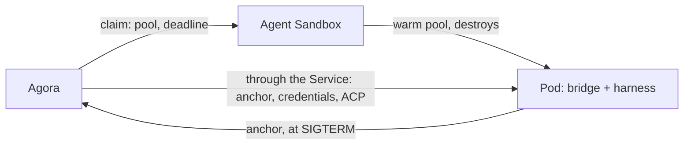

# ADR 000n — Executions

- **Status:** accepted
- **Date:** 2026-09-27

## Context

- Agora needs harnesses (claude-code, codex, …) running in isolated, disposable environments;
  it talks ACP with them and finds the work again after an interruption.
- A harness is hostile: it must hold neither Agora's credentials nor a database login.
- Starting a harness takes seconds; the user should not wait for it.
- Agora does not run infrastructure: no Pod controller, no reaper of its own.
- An agent's work outlives its turns: a harness moves a long command to the background and ends
  its turn (ADR Steering); an agent waits on CI, a build, a deployment. A sandbox destroyed under
  that work loses it.

## Decision

1. **Agent Sandbox provides executions.** It is a prerequisite, like Kubernetes: a warm pool per
   harness image, one claim per execution; Kata isolates each Pod in a VM.
2. **A claim carries only a pool and a deadline.** Everything specific to an execution — the
   anchor to restore, the credentials, the ACP session — reaches the sandbox through the bridge,
   after the claim, via the Sandbox's Service. What Agora remembers is in its log.
3. **Agora only sets the deadline**, renewing it while its agent is in a turn or work the agent
   started still runs in the sandbox, up to a ceiling of 6 hours since the last prompt; once
   nothing runs, one lease. Stopping is no longer renewing.
4. **The bridge says what runs; the log decides.** The bridge lists the processes under the
   adapter; work runs while one started since the execution's first prompt is there.
5. **Only the infrastructure destroys**, at the deadline.
6. **The Pod saves itself**: at SIGTERM it pushes the harness's native files — the anchor — to
   Agora, proving its identity with its projected ServiceAccount token.

## Why

- **One actor destroys.** No race between Agora and the infrastructure; Agora needs no `delete`
  permission.
- **A warm pool hides the start.** Ready in 0.29 s from the pool, 3.8 to 5.4 s cold.
- **Every sandbox of a pool is interchangeable.** Since nothing specific to an execution goes
  through the claim, any warm sandbox fits any claim of its pool.
- **The Pod knows when it dies.** Pushing at SIGTERM avoids Agora racing its own WATCH against
  the Pod's death.
- **Agora survives its own restart.** The claims say which executions still exist; the log says
  where each one stands.
- **The agent's work, not a clock, decides.** Under a one-hour turn cap, two runs started at 16:11
  and 17:11 were destroyed at 17:11 and 18:11, both waiting on CI (Agora's own runs, reported on
  2026-11-26); a command moved to the background was destroyed one lease after its turn. The
  person chose the rule: alive while a turn runs or work it started still runs, at most 6 hours
  after the last prompt, the lease starting once nothing runs.
- **Processes are what every harness shares.** Claude Code's adapter reports its background tasks
  in ACP (claude-agent-acp 0.106.0, `async_task_*` updates, code read); Codex and opencode say
  nothing of the kind. Every one of them runs the agent's commands as processes under its adapter,
  which the bridge reads from `/proc`.
- **What started before the first prompt is the harness's.** claude-agent-acp spawns the Claude
  Code CLI before it answers `session/new` (0.106.0, code read): counted, it would hold every
  sandbox to the ceiling.

Measured on g4 under Kata, 2026-09-27, replayed 2026-09-29: the 22 execution cases of the lab
script pass. What each one proves is recorded in `reliability/executions.md`.

## What we tried

| Option | Why not |
| --- | --- |
| Agora deletes claims or Pods | A single actor destroys: the infrastructure. No reaper, no `delete` permission. |
| A Pod controller or reaper of our own | Agent Sandbox already does it. |
| A persistent volume (PVC) in the sandbox | Against the principle, and a PVC on the claim forces a cold start. |
| Renewing between two turns, whatever runs | First rejected: the lease after the turn seemed enough. Revisited: it is not when work goes on after the turn, so Agora renews between turns, but only while that work runs; renewing regardless would keep every idle sandbox to the ceiling. |
| A one-hour turn cap | Destroyed agents that were still working, waiting on CI (above). The ceiling bounds a runaway agent instead, from its last prompt. |
| Work as ACP reports it | Claude Code's background tasks only; nothing from Codex or opencode. |
| Work as any process under the adapter | The harness's own processes, its CLI or an MCP server, would hold every sandbox to the ceiling. |
| Work as a process outside the adapter's process group | Where a harness puts a command is its own choice, from one version to the next: no contract to stand on. |
| Agora pulls the anchor during the grace period | A race between its WATCH and the Pod's death; only the Pod knows when it dies. |
| Saving at every turn | The anchor only matters at the end of the Pod; before that, the live sandbox is the reference. A Pod ending without its anchor is an incident — the node dying — and the log gives the next Session what it missed. |
| The Pod writes to Agora's database | No database login in an untrusted sandbox. |
| A secret or identity injected through the claim | Forces a cold start and puts a secret in the sandbox. |
| Agora's state in annotations on the claim | Used while Agora had no database; beside the log, every annotation duplicated an entry: two sources for the same facts. |
| Reaching the Pod by its IP | The Service is the native building block; the Pod no longer needs to be reached during its grace period. |
| Network rules by domain name | The Cilium DNS proxy's responses do not reach a Kata VM. |
| Agent Sandbox's upstream router | Agora relays the WebSocket itself. |

## Consequences

- A stop frees the resource at most one lease later.
- A new image is a new pool: its name follows the image's digest.
- If Agora is unreachable during the grace period, or the node dies, the sandbox leaves without an
  anchor; the next execution gets the exchanges from the log, as text.
- A turn, and work left running, last at most 6 hours after the last prompt; such an execution
  counts against the active ones until then, unless stopped.
- A process a harness starts for itself after the first prompt and keeps (a language server opened
  on a file) counts as work: its sandbox lives to the ceiling.
- Between turns, Agora asks each bridge what runs at most once a minute, until the deadline passes.
- The execution's token is renewed as the deadline moves, during a turn too: a renewal keeps the
  tunnels open, closed a moment before the token they carry expires.
- Restoring from an anchor opens a new Session and pays for the whole context again.
- Kata constraints: no FQDN network rules (plain DNS and address ranges), and clock sync
  disabled in the guest (`systemd.mask=chrony.service`).
