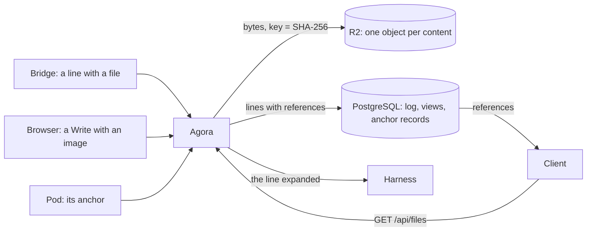

# ADR 000n — Files

- **Status:** proposed
- **Date:** 2026-11-08

## Context

- Files reach Agora three ways: the anchor a Pod pushes when it ends (a harness's native files, up
  to 32 MiB), a person's attachments (prompt blocks, up to 12 MiB a message), and the files a tool
  returns to the agent (Claude Code's `Read` of a PDF or an image).
- ACP carries a file inline, as base64, and the log writes every line whole (ADR Log). The views
  copy what they fold.
- A thread is read whole when it opens, and the client keeps it in memory.
- CloudNativePG backs PostgreSQL up physically: a full base backup each day, kept 7 days, and every
  WAL segment.
- A sandbox is hostile.

## Decision

1. **A file lives in R2**, in a bucket of Agora's own, as one object per content: its key is the
   SHA-256 of its bytes. Anchors, attachments and the files a tool returns alike.
2. **Everything else holds a reference.** When Agora writes an entry, each base64 string of 64 KiB
   or more becomes a reference, and the entry lists where. An anchor's record names its object. The
   views copy the references.
3. **Only Agora writes to R2**, and it names each object from the bytes it hashed itself. Bytes
   reach it as before: in the lines, in a Write, in the anchor's push.
4. **The line is still whole.** Expanding its references gives the line back, byte for byte; that
   is what Agora sends to a harness.
5. **A file goes when nothing names it any longer**: a sweep deletes the objects no entry and no
   anchor references, once they are a day old. It never runs while a file is being stored.
6. **The bytes already in PostgreSQL move once**, each line checked to expand back to what was
   stored.

## Why

- **Each file once.** Measured on agora-pg, 2026-11-05: an image a tool returned was stored 3
  times in `entries`, twice in `objects`, and again in its anchor; base64 was stored as it came
  (49.0 MB of lines took 48.0 MB). Claude Code's `Read` made 119 MB of the 297 MB of `entries`, for
  100 distinct files and 35 MB of bytes. With the SHA-256 as the key, one content cannot be stored
  twice.
- **The thread carries what it shows.** One Workstream's thread was 69 MB, 1.2 MB of it not files.
  Headless Chromium took 7.5 s and 1.3 GB of heap to open it, against 0.6 s and 39 MB for a 1 MB
  thread (2026-11-05, over loopback).
- **Backups stop copying files.** A physical backup cannot leave a table out, but an unlogged one,
  which PostgreSQL empties after a crash. In PostgreSQL a file goes into the WAL and into each of
  the 7 daily base backups; in R2 an object is stored once. The anchors alone took 135 MB on disk,
  and about 154 MB of them were written the week of 2026-11-02.
- **R2 is already where Agora's data goes.** The backups are there: the files are no more exposed
  than they are today. Egress is free; storage is free up to 10 GB a month, then $0.015 per GB
  (Cloudflare's documentation, read 2026-11-08). No service runs in the cluster for it, and it
  outlives the node's disk.
- **Agora writes, because R2 checks no SHA-256.** A PutObject is checked against `Content-MD5`;
  R2's SHA-256 checksum is composite only (Cloudflare's documentation, read 2026-11-08). A sandbox
  allowed to upload could put other bytes under a real file's key, and every Workstream naming it
  would read them.
- **Faithful still.** A reference stands for a value Agora gives back exactly: the log keeps what
  ADR Log asks of it, the line as exchanged, every member and number.

## What we tried

| Option | What we found | Verdict |
| --- | --- | --- |
| Files inline in the lines | The copies, the backups and the thread above. | Dropped. |
| One table of files in PostgreSQL | One copy, but in the WAL and in every base backup, read through the server's memory; no way to leave it out of the backups. A relational database is not where files belong. | Dropped. |
| A volume of the cluster | Lost with the node's disk, unless a job copies it to R2: two stores for one need. | Dropped. |
| An S3 server in the cluster (Garage, SeaweedFS) | One more stateful service on one node, which needs its own copy to R2. | Dropped. |
| Uploads straight to R2 by signed URL, from the browser and the Pod | Spares the server the bytes; but R2 checks no SHA-256, so a sandbox could poison a key. | Dropped. |
| A key per Workstream | Deleting a Workstream would delete its prefix; but one content is stored once per Workstream, and a file handed to a delegate is copied. | Dropped: one object per content. |
| No bytes kept for the files a tool returns | Nothing reads them back today; nothing could show them later either. | Dropped: a file lives in one place, whatever brought it. |

## Consequences

- R2 is a prerequisite: a bucket, a token for it alone, the server's way out to it.
- A line with a file waits for R2, as every line waits for PostgreSQL. Without internet, such lines
  wait; the models need internet anyway.
- A raw entry shows references, not base64; the line sent to a harness is the stored line,
  expanded.
- The client fetches a file from Agora when it shows it.
- Deleting a Workstream or replacing an anchor deletes no object: the sweep does, once nothing
  references it.
- Storing a file and sweeping exclude each other: a line with a file waits while a sweep runs.
- Any base64 value of 64 KiB or more is stored as a file, whatever it holds; its readers see no
  difference.
- An anchor keeps its format and its 32 MiB limit: only where its bytes live changes.
- Moving the existing bytes rewrites `entries`, the one time stored history changes; each line
  reads back the same once expanded.
