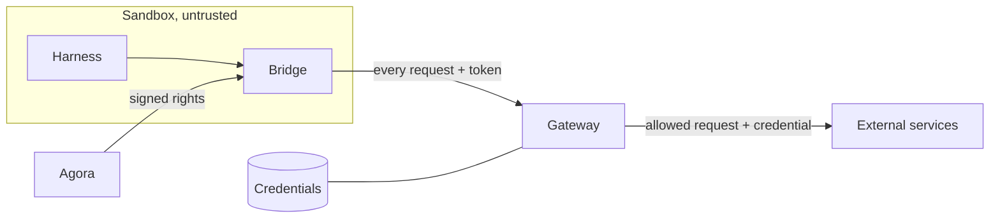

# ADR 000n — Gateway

- **Status:** accepted
- **Date:** 2026-10-02

## Context

- A harness runs in a sandbox treated as hostile: any installed tool can run, any file can be
  read. A credential inside can be copied and replayed elsewhere.
- It still needs external services: Anthropic for the model, GitHub for code.
- Rights differ per execution and combine, often on one host: write on repo A and read on
  repo B are both `api.github.com`.
- The sandbox starts in a warm pool, before the execution exists: its environment cannot carry
  a per-execution secret.
- A harness may need its services before any execution: its SDK initializes against them, and
  stalls without a way out.
- Agora does not run infrastructure: Kubernetes and Agent Sandbox are prerequisites it uses, not
  components it ships.

## Decision

1. **No credential in the sandbox.** Everything it sends out goes through a gateway — a
   prerequisite, like Kubernetes and Agent Sandbox: agentgateway, deployed by the
   infrastructure.
2. **Agora signs rights into short-lived, self-contained tokens**, and does nothing more: it never
   holds a credential. A warm Pod gets its pool's base profiles, the services its harness needs
   before any execution; an execution gets those and its own, before `initialize`.
3. **The gateway checks every request against that token**, then sets the credential it alone
   holds.
4. **The credential bounds, the grants cut.** One credential per host, as narrow as possible;
   each execution gets only the share its token grants.
5. **Agora alone hands tokens to bridges.** Every 5 seconds it looks at the pools' Sandboxes and
   warms the ready ones; it swaps the token at the claim; replacing a token closes the tunnels
   opened with the previous one.
6. **A token works only from its Pod.** It names the Pod's address, which Agora takes from the
   Sandbox; the gateway refuses it from any other address.
7. **GitHub reads as the public sees it, with the Internet.** What no grant covers on GitHub takes
   routes of its own, open to the Internet's grant, for reads only, with the same PAT: a public
   repository can be cloned and read, never written to or pushed to without its profile.
8. **On an MCP server, the grants name the tools.** Every call is a `POST` to one path: a grant
   carries the tools a call may name, and the server's route, an MCP backend of the gateway, checks
   the tool in the protocol before it sets the server's credential.

## Why

- **Any combination fits in one token.** Nothing is created or cleaned up per execution or per
  combination.
- **The gateway decides alone.** Everything it needs is in the token: no state to keep in sync,
  no call to Agora per request. Changing an execution's rights is issuing a new token.
- **Secrets live in one place.** Agora never sees them; the sandbox holds a token that expires
  and only works through the gateway, for its grants.
- **Two rules, one log.** The routes with a credential share one rule, the Internet's route has its
  own; each request leaves a line: execution, method, path, status, reason.
- **Warming is the same for every harness.** What differs is declared with the pool — its base
  profiles — not built into Agora or the bridge. A single issuer keeps the order: a late warming
  cannot replace an execution's token, and closing old tunnels makes the new token the only one
  in use.
- **Secrets change like the rest of the infrastructure.** A SOPS commit; the gateway reloads it
  without a restart.
- **agentgateway does all of it natively** (read in its v1.5.0 code, measured on g4): a `CONNECT`
  listener with TLS interception by its own CA, the JWT read from the `CONNECT` headers, one CEL
  rule over the claims and the request's host, path and method, and credentials read from files
  it watches. Apache-2.0, under the Linux Foundation.
- **A public repository belongs to the Internet.** Anyone may read it; an agent with the Internet
  reads public code all day, and failing on it served nothing. A fine-grained PAT always reads every
  public repository, so the credential is already there; the gateway keeps it to reads, as it keeps
  "read B" from writing to B. agentgateway 1.6 runs a listener's policies before it picks a route
  (read in its code), so a request can be marked covered by a grant or not, and routed on that.

Measured on g4 under Kata, 2026-09-29: with a PAT able to write to two repos, an execution
granted "write A, read B" created a file on A (201) and was refused the same write on B (403);
Haiku answered through the gateway. On 2026-09-30, same image: claude-code's first Session
opening took 20,236 ms when the token came after it — its SDK retried against the bridge's
refusals, 14 of them — and 2,518 ms when the token came before `initialize`.

## What we tried

### OneCLI 1.45 (previous implementation)

Stored credentials, injected them, granted each OneCLI *Agent* a selection of secrets; one Agent
per Pod incarnation. Dropped for its identity model (verified live, 2026-09-06):

| Finding | Consequence |
| --- | --- |
| One permanent token per Agent (`aoc_…`), no expiry. | An Agent created and deleted per execution. |
| Creation not idempotent (409), no lookup by identifier. | A lost answer meant listing every Agent. |
| `GET /agents` returns every Agent's token. | Whoever lists can impersonate any Agent. |
| A second secret of the same type broke grant resolution. | Two credentials for one host could not coexist. |

### OneCLI 2.x

v2.0 (2026-08-18) turned OneCLI into a hosted-agent platform — one durable sandbox per agent,
runner, Slack — overlapping Agora and Agent Sandbox. Read in the v2.6.0 code:

| Finding | Consequence |
| --- | --- |
| Still one permanent token per agent; no route takes a lifetime. | No per-execution identity that expires. |
| A grant is a policy rule "one agent, one secret"; agent groups removed. | Composition only on permanent agents, rewriting the workspace policy per grant. |
| Two secrets for one host: order is the database's row order. | The injected credential is not deterministic. |
| Role checks and fine scoping need an enterprise licence. | Not in the open-source edition. |

### Agent Vault 0.39.3 (Infisical)

Built and measured (g4, 2026-09-28): the bridge's proxy to Agent Vault's MITM proxy, one proxy
session per execution; Haiku answered through it. The bridge and the post-claim hand-off were
kept as is. Dropped because it does not compose, and for what it demands of Agora:

| Finding | Consequence |
| --- | --- |
| A session covers a whole vault; services match host and path, not method. | "Write A, read B" cannot be expressed. |
| A request goes through one vault; the path is hidden in TLS from the bridge. | One vault per profile cannot be combined on one host. |
| Minting a session requires `member`, which can also read, set and delete credentials. | Agora would hold every secret it hands out. |
| Per its documentation, the enterprise edition adds method and path filters, still one vault per session. | Same limit, licensed. |

### Other ways for the token to carry the rights

| Option | Why not |
| --- | --- |
| An opaque token the gateway resolves with Agora | State and a lookup per request; Agora on the critical path of every call. It is Agent Vault's session model. |
| An identity per execution, created in the gateway | Created and cleaned up per execution; it is OneCLI's Agent model. |
| Profiles in the token, expanded by the gateway | Moves the profile catalogue into the gateway's configuration. Kept in reserve if tokens grow too big (tens of repos). |

### Warming on Sandbox events

Watching the Sandboxes — a list then a watch, as Agora does for the claims — would hand a warm Pod
its token as soon as it is Ready rather than within 5 seconds, with a timer per Pod for renewal.
Not kept: a second watch to resume (expired versions, reconnections), timers to arm and cancel
through Ready flips, adoptions and deletions, and a periodic resync kept anyway in case an event
is missed. The sweep repairs itself after a restart or a cut, and renews in the same pass.

The 5 seconds cost nothing measured: the execution's token leaves on the claim's event, which the
claims' watch already gives, before `initialize` — that is where the 20 seconds went. A warm token
only matters to a harness initializing in the pool. codex does — it asks ChatGPT for its models and
its account as soon as it starts — and when that comes before the sweep, those calls are refused:
7 in one of two runs (g4, 2026-10-03), with no effect on the Session, ready in about half a second
on a warm Pod. Reconsider when the delay shows in the Session opening, or when the pools grow to
where a list every 5 seconds weighs.

### The Pod asking for its token

The bridge could ask Agora for a warm token at start, authenticated by its projected
ServiceAccount token as for the anchor. Dropped: the bridge would need renewal, and retries while
Agora is away; and a warm token asked just before the claim could arrive after the execution's
and replace it. Closing that race means teaching the bridge which token wins — the order a single
issuer keeps for free.

### A short-lived credential per execution

A GitHub App installation token scoped per execution. Dropped: per-execution state and cleanup
in Agora, composition carried by the credential rather than the policy, GitHub only.

### One vault per combination

Dropped outright: vaults grow with the combinations.

### The Internet, narrower (studied 2026-10-05)

| Option | Why not |
| --- | --- |
| `GET` and `HEAD` only | A query string carries what a body would: it narrows little, and breaks `POST`-only APIs. A grant can still carry methods, should a narrower profile be wanted. |
| A list of hosts (registries, documentation) | One more change for every site an agent needs; each such list can still be a profile of its own. |

Measured with agentgateway 1.5.0 run locally on the configuration infra-k8s deploys
(2026-10-05): with `internet`, example.com, the npm registry and a `POST` answered; without it,
403; with `internet` alone, Anthropic, z.ai, `api.github.com` and `github.com` refused (403); an
address instead of a name refused at TLS; a port other than 443 refused on `CONNECT` (404); a
name resolving to a private address that refuses port 443 got that refusal back — what the
network policy is there to prevent.

### Binding the token to a secret of the Pod (studied 2026-10-06)

| Option | Why not |
| --- | --- |
| The Pod's projected ServiceAccount token | A file the agent's user can read, and the same ServiceAccount for every sandbox: a second bearer token, taken along with the first. |
| A key held by the bridge (mTLS, proof of possession) | The agent can read the bridge's memory, the key with it. Viable once the bridge runs under a user of its own. |

The address needs no secret: the network gives it, and a Pod cannot send from another's.
Measured with agentgateway 1.5.0 run locally on the configuration infra-k8s deploys
(2026-10-06): a token naming another address than the one it came from, 403; with no address,
403; from its own address, let through. On g4, the gateway sees each sandbox's own address.

### Public GitHub through the Internet (2026-10-12)

Until then `github.com` and `api.github.com` had one route each, setting the PAT, so the Internet
left GitHub closed, public repositories included.

| Option | Why not, or why |
| --- | --- |
| No credential on the public routes | Kept out: 60 REST requests an hour, shared by every sandbox behind the operator's address, and GraphQL refused. |
| A second PAT that reads public repositories only | GitHub would keep it to reads, GraphQL could open, and a private repository on the main PAT would stay hidden. Kept in reserve: one more secret, for limits that do not bind today. |
| The same PAT, reads only (kept) | No new secret. The gateway refuses every write, as for a repository granted read; GraphQL stays closed, a `POST` whether it reads or writes. Holds while the PAT reaches no private repository. |
| A list of the paths of the repositories not granted, refused | GitHub reads a repository through too many paths — search, `/repositories/{id}`, codeload — for a list to close it. |

Measured with agentgateway 1.6.0 run locally on the configuration infra-k8s deploys, with the
real PAT (2026-10-12): with `internet` alone, a public repository and an offered one not granted
read (200, the PAT's limit of 5,000 an hour), cloned by git, fetched; a push, a `POST`, a `PATCH`,
a `DELETE`, GraphQL, a forged `x-gateway-grant: covered` with a write, a token from another
address: 403 from the gateway, and no branch on GitHub; what a grant covers through `github-api`
and `github-git` as before; without `internet`, 403. The header, sent by the sandbox, reached
an echo service overwritten, and not at all through a route that removes it.

### Read and write on one MCP server (2026-10-26)

The vault's MCP server reads and writes through the same `POST /mcp`; the tool is in the JSON-RPC
body. It takes one identity, a Pocket-ID machine client, and knows no levels.

| Option | Why not, or why |
| --- | --- |
| A path or method per level | There is none: host, path and method are the same for `read_note` and `delete_note`. |
| A regular expression on the body (CEL `request.body`) | Reads JSON as text: a batch, a key order, an escape or a second `name` defeats it. |
| Two identities, one per level, the server telling them apart | A change in the server, which the levels belong to no more than the GitHub PAT does; the gateway would still have to route by level. |
| The tools in the grant, checked by the gateway's MCP backend (kept) | agentgateway parses the protocol: `mcpAuthorization` runs a CEL rule on each `tools/call` and filters `tools/list`, with the JWT's claims in scope (read in its 1.6.0 code). One rule for every composition, as on the other routes; a tool the grants do not name never reaches the server. Measured with the 1.6.0 binary on the configuration infra-k8s #295 renders (2026-10-26): a grant naming the six read tools listed those six and was refused `create_note`; a grant without `tools` listed the twelve and the prompt. |

### Other gateways (surveyed 2026-09-28)

| Candidate | Why not |
| --- | --- |
| Octelium | Composes natively, but reverse proxy only (base-URL rewrites, awkward for `gh`), AGPL, one maintainer, heavy install. |
| Envoy + OPA | The serious fallback, GraphQL checks included — but building our own gateway. |
| Pomerium, Teleport, StrongDM, Aembit, Keycard, Tailscale Aperture | Reverse proxy, no path and method rules, secret in the Pod, or hosted service. |
| LiteLLM, Kong, Envoy AI Gateway | LLM only: no git, no GitHub. |
| tokenizer (Fly.io) | Elegant model, but refuses `CONNECT`; no release since 2023. |

## Consequences

- The agent can read its token: it runs under the bridge's user. The token is bound to the
  Pod's address rather than kept secret (shown on g4, 2026-10-06: the token was readable from the
  agent's user). An address reused by a new Pod within a token's life could use that token, if it
  ever got it.

- The gateway is on the critical path: when it is down, external operations fail, with no
  automatic escalation.
- A new host with a credential needs a gateway route and a profile in Agora's catalogue, reviewed
  as code. Any other host is the Internet's: one more route, without hosts, which agentgateway
  picks last (read in its v1.5.0 code: exact host, then wildcards, then no host) and which sets
  no credential, open to a grant on `*` — the `internet` profile. Routes with a credential match
  the grant's host against the request's, so the Internet never opens them; GitHub's public routes
  read `*` too, for reads only.
- The `internet` route can name any host: the gateway's egress is limited to public addresses on
  port 443, so no name leads it into the operator's networks or the cluster — but for the cluster's
  API server, which `kubernetes:read` needs. The `internet` route reaches it too, with no
  credential: the API server must serve the anonymous nothing but its version and health.
- With the Internet, an agent steered by what it reads can send what it holds anywhere — a
  repository it was given included; credentials stay in the gateway. It is never a base profile,
  and an execution gets it only when its Create or a Scope names it: the interface names it for a
  new Workstream, and the user can turn it off.
- A JWT cannot be revoked before it expires: keep it short, and Agora reissues it — in the pool
  while the Pod waits, and between turns during an execution, where closing tunnels interrupts
  nothing.
- A warm Pod can reach its base services before anyone uses it: base profiles are reviewed with
  the pool, cover services only — never a repository — and its token names the Pod.
- A Pod waits up to 5 seconds after being Ready for its warm token: a claim in that window starts
  without one, and still gets the execution's before `initialize`.
- Whether a harness uses the way out to initialize in the pool is its own capability; a warm
  token makes it possible, it does not make it happen.
- The token grows with the grants: a few hundred bytes for a few repos. Tens of repos would call
  for profiles expanded by the gateway instead.
- GitHub GraphQL stays closed: the targeted repo cannot be checked there.
- The PAT must reach no private repository: through the public routes, an execution with the
  Internet reads whatever it reads. Offering a private repository means a second credential on
  those routes, reading public repositories only.
- A credential that rotates — the ChatGPT session codex uses — needs a refresher beside the gateway,
  and a login of its own: its refresh token may be spent once, so nothing else may hold it.
- What is not Node trusts the gateway's CA by other means than `NODE_EXTRA_CA_CERTS`: codex, a Rust
  binary, through `SSL_CERT_FILE`; git through `GIT_SSL_CAINFO`.
- agentgateway is young and moves fast (1.5 made `iss` and `aud` mandatory): pinned by digest,
  upgraded deliberately, live cases replayed first.
- Replacing the gateway leaves the bridge's side unchanged: a token handed at runtime, joined to
  each `CONNECT`.
- An MCP server's route terminates the protocol: agentgateway reads every message and speaks to
  the server itself. A replacement gateway has to parse MCP too, or the levels collapse into one.
- A tool the server adds is closed to the read level until the catalogue names it: the lists follow
  the server's releases.
