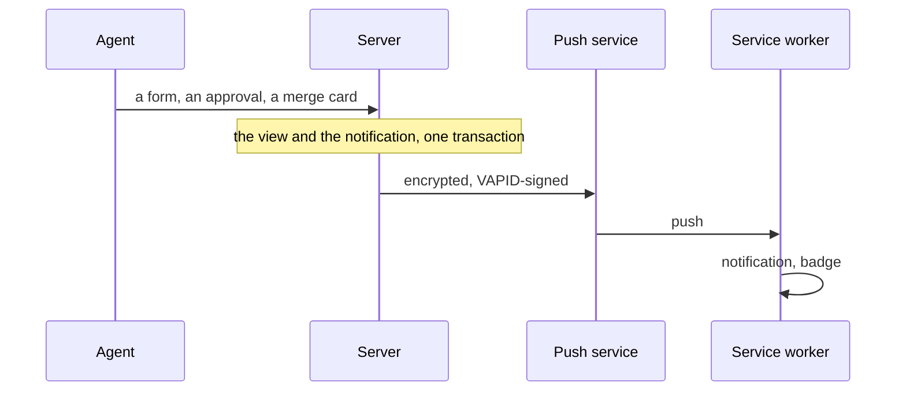

# ADR 000n — Notifications

- **Status:** proposed
- **Date:** 2026-11-21

## Context

- An agent that waits on the person waits until the person looks. Three cards wait on the person: a form
  the agent asks (`AskUserQuestion` in Claude Code, `request_user_input` in Codex), a delegation's approval,
  which expires after 4 min 30 s, and a merge card.
- The person follows Agora mostly from an iPhone, through the client added to its Home Screen
  (`manifest.webmanifest`, `display` `standalone`); a desktop browser comes second.
- iOS suspends a Home Screen web app in the background: no connection of its stays open, and the list's
  "waiting for you" is seen only once the app is opened.
- The client is served at `agora.bretagne.dev` behind oauth2-proxy and Pocket-ID; the server's Pod reaches
  the Internet on 443 (infra-k8s, `apps/agora/networkpolicy.yaml`).
- There is one person, the operator, and no native application.

## Decision

1. **Web Push, the standard.** A service worker of the client subscribes through the Push API; the server
   sends to each subscription's endpoint, VAPID-signed (RFC 8292), the payload encrypted (RFC 8291). One
   implementation for iOS 16.4 and later, added to the Home Screen, and every desktop browser.
2. **Only what waits on the person.** A form shown to the person, an approval, a merge card: each once, when
   it becomes pending. Not a permission, not a turn's end, not an execution's failure.
3. **Light.** The Workstream's title, the card's kind and its first line; the person reads the rest in the
   client.
4. **Declarative payload.** The payload is Safari's declarative Web Push message, which Safari 18.4 and later
   shows by itself, its badge included; the service worker shows the same message where the browser does not.
5. **Written with the view.** A notification to send is written in the transaction that makes the card
   pending, and sent from there: never lost, never twice, a restart included.

## Why

- The Push API is the only way to wake a suspended Home Screen web app on iOS (WebKit documentation, "Web
  Push for Web Apps on iOS and iPadOS", 2023-02); the same API reaches Chrome, Edge, Firefox and Safari on
  macOS, so the iPhone and the desktop are one code.
- The cards are what blocks an agent: a notification for anything else would teach the person to ignore
  them. An approval left unanswered fails its delegation after 4 min 30 s.
- A declarative message is shown even when the service worker does not run or fails (WebKit, "Meet
  Declarative Web Push", 2025-03), and Safari revokes a subscription whose pushes show nothing.
- The payload is encrypted end to end: the push service relays bytes it cannot read.

## What we tried

| Option | Found | Dropped because |
| --- | --- | --- |
| A native iOS application with APNs | Needs an Apple developer account, a signed build, a store or TestFlight | A second client to build and ship for one person. |
| ntfy, Pushover or a Telegram bot | Another application on the phone, a third party relaying the text | The tap opens that application, not the card; the text leaves Agora in clear. |
| E-mail | Pocket-ID knows the address | Minutes late, against an approval's 4 min 30 s. |
| Polling from the client | iOS suspends the web app | Nothing runs while it is closed. |
| Every change of state (a turn done, an execution failed) | What the list already shows | Decided against by the person: the three cards only. |

## Consequences

- The server holds a VAPID key pair: a new secret in infra-k8s, given as environment. Without it, nothing is
  sent and the client offers no notifications.
- The server sends to the push services' hosts directly, as it reaches R2, not through Agora's gateway.
- On iOS a subscription exists only in the app added to the Home Screen, and a new one each time it is added
  again; the server forgets those the push service says are gone.
- iOS shows no action buttons: a notification opens its Workstream, and the card is answered there.
- A notification cannot be taken back by a push without showing another: the client closes those whose card
  is answered when it opens.
