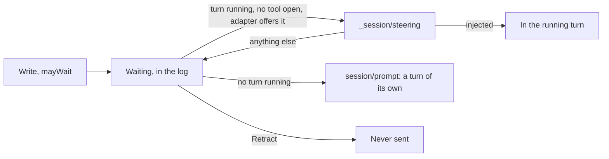

# ADR 000n — Steering

- **Status:** proposed
- **Date:** 2026-11-04

## Context

- A person, or an agent, often has something to add while a turn runs. Agora refused it (`turn_active`),
  and the composer was closed until the turn ended.
- A Workstream takes one turn at a time: no adapter refuses a second `session/prompt`, and what each
  does with one differs (ADR Log).
- ACP has an extension for this, `_session/steering`: a message for the running turn. Claude's and
  Codex's adapters offer it; opencode does not.
- A flow waits for a turn of its own for each prompt it writes (`flows.md`).

## Decision

1. **A message written during a turn waits in the log.** A Write says it may wait (`mayWait`): accepted
   during a turn, with no line. Without it, nothing changes: `turn_active`.
2. **It goes into the running turn when the adapter can take it**: one `_session/steering`, the oldest
   message first, always asking `promptRequired` for a turn that has ended.
3. **Otherwise it goes as the next turn**: the same message, by `session/prompt`. Every harness has
   this path; steering falls back on it.
4. **One gesture for the person.** Send; Agora decides. A message that has not gone yet can be retracted.
5. **Agora holds a steer while a tool of the turn is open, after a Cancel, and during a permission,
   a question or an approval.** The message is read at the agent's next step, the same way on every
   harness.
6. **A Cancel holds the messages waiting** until the person's next message: it goes behind them.

## Why

- **One primitive, two ways out.** The queue works everywhere and needs nothing from the adapter;
  steering makes the answer come sooner where the adapter can. A failed steer loses nothing: the
  message is still in the log.
- **A flow keeps its contract.** It reads its turn from what it wrote, so it never says `mayWait`, and
  no code path of the flows or of the API's callers changes.
- **A steer during a running tool disturbs Claude, not Codex.** Measured in real sandboxes through the
  gateway, 2026-11-04, claude-agent-acp 0.100.0 (Haiku) and codex-acp 2.5.0 with codex 0.165.0
  (gpt-6-luna):

| Situation | claude-agent-acp 0.100.0 | codex-acp 2.5.0 |
| --- | --- | --- |
| No turn running | `promptRequired`, nothing starts | The same |
| Generating text | `injected` within 80 ms; honoured; one `end_turn`; generation cut and restarted, the text so far said again | The same |
| Twice in a row, 800 ms apart | Both honoured | Both honoured |
| At the first chunk of a short answer, three times | Honoured each time, one answer each | The same |
| After `session/cancel` | `injected`, `cancelled` answered, then its word said about 900 ms after that answer | `promptRequired`; nothing more |
| During a shell command of 40 s | `injected`; the tool line `completed` at once, "moved to the background"; the turn ends about 5 s later without the result; about 30 s after, outside any turn, the agent reads the result and honours the message | `injected`; the command ends in its time; honoured; one `end_turn` |
| During an MCP call of 30 s | The same: moved to the background, the turn ended, the result and the message said about 22 s after its end | The call ends in its time; honoured |
| A session the deployed version wrote (0.85.1 with CLI 2.1.288; codex-acp 2.1.1 with codex 0.159.3), resumed by this one | The agent recalls the word it was given | The same |
| As a tool line closes, more to do | `injected` in 4 ms; the next tool ends with its own result; honoured in that turn; one `end_turn`; nothing in the 30 s after | `injected` in 40 ms; honoured in that turn; one `end_turn`; nothing in the 30 s after |

- **Holding the steer gives Claude what Codex does by itself.** Sent as a tool line closes, the message
  reaches the agent with no tool to move. Otherwise a turn would end while its work goes on in the
  background, where nothing renews the execution's deadline: the Pod can end under it.
- **`injected` means accepted, not read.** On neither adapter does a message come back as a line: the
  log is its only record, and a `user` element is folded from that answer.
- **Agora's validator takes the new adapters' lines.** Every raw line of a session — text, a failing
  command, files written and edited, a Cancel, a steer — replayed through the pinned schema, SDK 1.5.1:
  none refused, on either adapter.

## What we tried

| Option | What we found | Verdict |
| --- | --- | --- |
| The queue alone | Works everywhere; a correction reaches the agent only when its turn ends, which can be an hour. | Kept as the way every harness has, not as the only one. |
| Steering at once, whatever runs | Measured above: on Claude, the turn ends without the tool's result. | Dropped. |
| A second `session/prompt` | The adapters disagree (ADR Log). opencode reads it at its next step, both requests answered at idle, with a window where a message goes unanswered (code read, 1.18.34). | Dropped. |
| A Write that always waits | A flow's Write would be accepted with no turn to wait for: its `Thread.turn_written` needs the prompt's `user` element, and it loops until then. | Dropped: a Write says it may wait. |
| Two gestures, as assistant-ui's lanes and Codex's terminal offer | A message saying "when you are done" is honoured by steering too (measured above): the second gesture adds a choice with nothing behind it. | Not now. |
| The waiting messages back in the composer after a Cancel, as Claude Code and Codex's terminals do | Text from several messages in one field, in one tab only, with a draft already there. | Dropped: they stay in the log, as assistant-ui's own queue keeps them. |

## Consequences

- The adapters must stay at or above the versions measured: claude-agent-acp ≥ 0.87 for steering during
  a streamed tool call, codex-acp ≥ 2.4 for `promptRequired`. An adapter that does not say
  `_meta.steering.supported` gets the queue.
- During a long tool, a message waits for it to end; to interrupt it, Cancel, then write.
- Generation restarts when a steer reaches it: the agent's text may say the start again, after the message.
- A steer sent as a tool starts, in the milliseconds Agora cannot see, is still moved to the background
  on Claude: its result then comes after the turn, in that turn's response.
- What an agent says after its turn's answer is shown, in that turn. Claude's own background tasks do
  this with no steer. The execution's deadline does not move for it.
- A `session/prompt` line can now be written long after its Write: the catch-up is chosen when it goes.
- A message held after a Cancel holds what comes after it: a flow's Write is refused `turn_active`, and it escalates after its 15 minutes, until the person sends or retracts.
