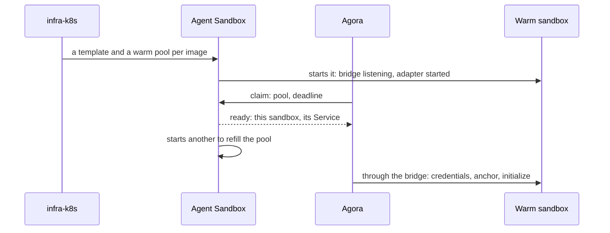
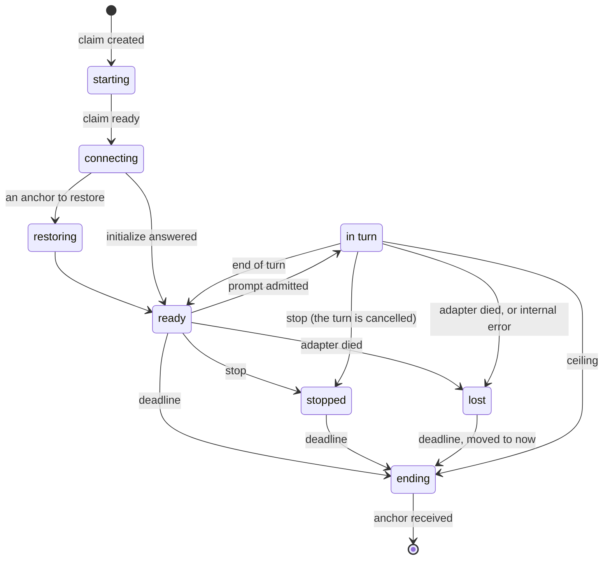
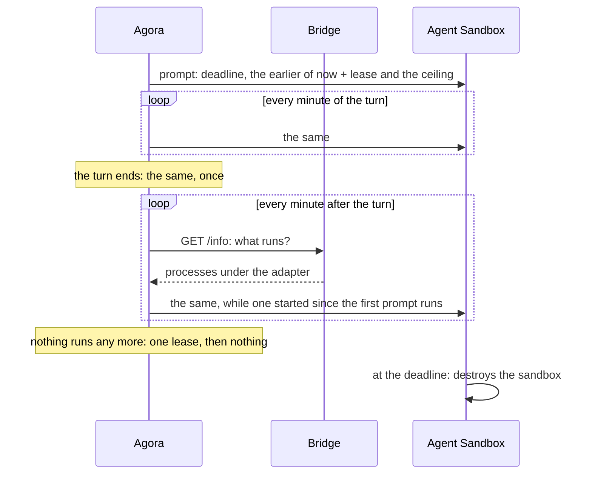

# Executions

An **execution** is a harness running in a sandbox obtained from Agent Sandbox. Agora creates no
sandbox: it requests one, talks ACP with the harness inside, sets the sandbox's deadline and
keeps its anchor when it ends.

## Who does what

| Actor | Role |
| --- | --- |
| infra-k8s | Declares a template and a warm pool per harness image, the Kata runtime, the network rules, the resources. |
| Agent Sandbox | Keeps the pools warm, hands out one sandbox per claim, destroys it at its deadline. |
| The image | A bridge in front of the harness's ACP adapter, both started in the pool, before any claim. |
| Agora | Requests the claims, moves their deadline, talks ACP with the harness through the bridge, stores the anchors. It never deletes anything. |

## Pools and claims

| Object | What it is | Declared by |
| --- | --- | --- |
| `SandboxTemplate` | The Pod of a harness: its image pinned by digest, the Kata runtime, the network rules. | infra-k8s |
| `SandboxWarmPool` | A number of sandboxes started from a template, waiting. One pool per image, named after its digest and labelled with its harness. | infra-k8s |
| `Sandbox` | One sandbox: a Pod and its Service. | Agent Sandbox, to fill a pool |
| `SandboxClaim` | A request: a sandbox from this pool, until this time. One per execution, with the execution's name. | Agora |

A claim carries only what Agent Sandbox reads: **the pool and the deadline**. Choosing the pool
is choosing the harness and the exact version of its image; Agora finds the pools by their
harness label.

Warming is the point. A warm sandbox has its Pod running, its bridge listening and its adapter
started, before any execution exists. A claim takes one, ready in a fraction of a second, and
Agent Sandbox starts another to refill the pool; when the pool is empty, one is created cold from
the template, in a few seconds. A used sandbox is never returned to the pool.

So every sandbox of a pool is interchangeable, and must stay so: nothing specific to an execution
goes through the claim, or the sandbox would have to be created for it, cold. The anchor to
restore, the credentials and the ACP session reach the sandbox through the bridge, after the
claim. Nor is the claim Agora's memory: what Agora must remember about an execution is in its
log.

## The life of an execution

The spec lists every state, including *uncertain* (the end of a turn could not be seen) and
*error* (the claim will not succeed).

## The deadline

Agora never destroys a sandbox; it only moves its deadline, and Agent Sandbox destroys it when
the deadline passes. The sandbox lives as long as its agent is in a turn, or work the agent
started still runs in it, and never more than 6 hours after the last prompt: the ceiling.

| Moment | Deadline |
| --- | --- |
| Creation | now + 10 minutes (the lease) |
| During a turn, every minute | the earlier of now + 10 minutes and the ceiling |
| End of the turn | the same, once |
| After the turn, every minute while work the agent started still runs | the same |
| Once that work has ended | the same, once, then nothing until the next prompt |
| The agent dies | now, once |
| Stop | nothing: Agora stops renewing |

Work still running is what the bridge sees: between turns, once a minute, Agora asks it which
processes run under the adapter, and counts those started since the execution's first prompt. A
command the harness moved to the background, a build, a wait on CI the agent left running: all of
them keep the sandbox, whatever the harness. What the harness started for itself before the first
prompt does not.

An execution with nothing running therefore disappears one lease after its last turn, or after the
last of the work its agent left running; a runaway agent, 6 hours after its last prompt. The
execution's outbound token follows: Agora hands a new one before the deadline would come within
half the token's life of its end, and the tunnels opened with the previous one go on until a moment
before it expires. A dead agent has nothing left to serve: its Pod ends at once, its anchor arrives, and
the next message continues the Workstream in a new execution. An agent is dead when its adapter
exits, or when the adapter answers a prompt with an internal error, which is how claude-agent-acp
reports that the Claude Code process under it died. The last prompt's start that bounds it is in the log, so a restart of Agora keeps the ceiling.

## The end of the Pod and the anchor

When the deadline passes, Agent Sandbox deletes the claim and the Pod receives SIGTERM. Within
the 30-second grace period, the bridge stops the adapter, reads the harness's native files as a
whole — the anchor — and pushes them to Agora. It proves which Pod it is with the projected
ServiceAccount token Kubernetes gives it; Agora checks it with a TokenReview. The Pod's claim
names the execution, and the log gives the session the anchor will resume.

Restoring an anchor puts those files back into a new sandbox, through the bridge once the claim
is ready and before `initialize`, and resumes the session there. Most harnesses read their files
when the session is resumed; one that opens them when it starts — opencode and its database — is
restarted by the bridge onto them, as its image declares. It is a new session for the model: the
whole context is paid again.

## Reaching the harness

Agora reaches each bridge through the Sandbox's Service, with a short token it signs for that
Pod. The bridge pipes the adapter's ACP lines to a single connection at a time, and back; it
numbers nothing and keeps nothing. Agora is that connection: it sends `initialize` itself on its
first connection, writes every line to the log before acting on it, and tracks each turn from the
ACP traffic.
