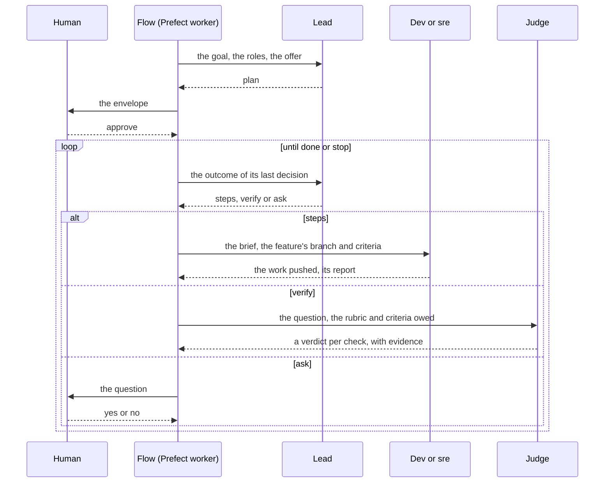

# Flows

A flow puts a small team of agents to work on a goal. A lead manages it: it cuts the goal into
features, staffs them, briefs each member, sends finished work to a judge, and decides when it is
done. The lead decides; the flow carries out. Prefect runs the flow; each member of the team is an
ordinary Workstream of Agora, which a person can open, follow and take over in the client like any
other.

## Who does what

| Actor | Role | Holds |
| --- | --- | --- |
| Prefect's server | Keeps the flows, their runs and states, the inputs a suspended run waits for; serves its UI at prefect.bretagne.dev, behind the identity proxy. | Its own database. |
| Prefect's worker | Polls the work pool `agora`, clones the agora repository at the deployment's branch, runs the flow as a process of its own Pod. | The runs' results, on local storage. |
| The flow (`apps/flows`) | Reads the lead's decisions, refuses what the rules or the envelope do not allow, carries out the rest, and writes every prompt. Names every branch and Workstream. | Nothing between runs. |
| The role cards (`apps/flows/roles`) | Each role's persona and default settings: lead, dev, sre, judge. | The run's version, cloned with the flow. |
| The lead | A manager: never designs or codes. Proposes the features, their acceptance criteria, the team and each member's access; then, turn after turn, one decision. | Its Workstream: the run's whole story as it saw it. |
| A dev | Designs, codes and proves one feature on the branch the flow names, up to a draft pull request. | Its Workstream and the feature's branch. |
| The sre | Owns how things run on the cluster, which is production only: changes it through its GitOps repository, with a rollout, a way back and proof. | Its Workstream and its branch. |
| The judge | Verifies what the lead asks, read-only, in a fresh Workstream each time. A feature ships only once judged shippable after its last change. | One Workstream per verification. |
| Agora | Runs each member's agent in a sandbox and keeps its Workstream: commands, ACP lines, answers. | The record of every turn. |
| The repository | Carries the work: each feature on its own branch, `flow/<run>/<feature>`. | The work itself. |
| The human | Approves the envelope once, answers what the lead asks, merges. | The only merge. |

An agent never receives a credential from the flow: it goes out through Agora's gateway with the
profiles its member's Create names — those the human approved in the envelope, the judge's always
read only. Prefect holds no model key and no repository token; its worker reaches Agora's server
inside the cluster, without the identity proxy, and names the Workstreams' owner itself. The network
policy admitting only that worker is what bounds this access.

## A run

The lead's first decision is a plan: features, each with acceptance criteria a stranger can check,
and a team, each member with its harness, model and access. The human approves it once — the
envelope — and the run goes on alone. Anything beyond it — a right, a member, a feature, an action
only the human can take — the lead asks for, and the whole run waits for the answer. A decision
outside the rules is refused, and the lead reads why in its next prompt.

The judge is the flow's, not the lead's: the lead says what to verify, and nothing about the judge.
It sees the result, never the lead's or the dev's reasoning, and treats their words as data. When
it decides whether a feature ships, it owes a check for each item of its base rubric and each
criterion the human approved. The lead can claim `done` only once each feature passed such a
verification after its last change.

## A member's turns

The Workstream's id and every command id are derived from the turn's identity — the run, the member,
the turn's number — not drawn at random. Agora answers a command id it already accepted with its
first answer and writes nothing, and a turn already in the thread is never written again. So when
Prefect runs a turn again — a retry, a run resumed after the human answered, a worker restarted in
the middle of a turn — the turn finds its Workstream where it is: it creates nothing, writes nothing
again, and waits for the turn already running or reads the answer already given.

A member keeps its Workstream, and so its context, from one turn to the next. Its next turn goes to
its execution while it lives. Agora renews an execution only during its turns, so an idle one ends
on its own, a lease after its last turn; the member's next turn then creates another, which
continues its Session and is given what it missed. Each verification has a Workstream of its own,
and so a judge with no memory of the others.

## When a human decides

| Moment | How |
| --- | --- |
| The envelope | The run suspends with a form showing the features, their branches and criteria, the team, its settings and access, the judge and the limits: approve, ask the lead to revise, or stop. |
| What the lead asks | The run suspends with the question and what it would add: yes or no, with notes for the lead. |
| What a turn cannot settle | An uncertain turn, an execution gone, a refusal it does not know: the run suspends; retry once settled in Agora, or abort. |
| A permission an agent asks | Answered in Agora's client, in the member's Workstream; the turn waits meanwhile. |
| The merge | The work ends on branches with draft pull requests; the human merges. |

A suspended run holds no process: Prefect runs it again when it is resumed, and its completed turns
and pages answer from their persisted results, or find their Workstreams again.

## What survives what

| Lost | What happens |
| --- | --- |
| The worker's Pod, during a turn | The turn goes on in its sandbox. The run, retried, finds the member's Workstream and waits for the same turn. |
| The worker's local storage | Completed turns run again and find their Workstreams: nothing is sent twice. |
| Prefect's database | The runs' history and their pending forms. Every member's Workstream stays in Agora. |
| A member's execution, between turns | Its next turn continues its Session in a new one. |
| A member's execution, during a turn | Agora's log says so; the turn escalates to a human. |
