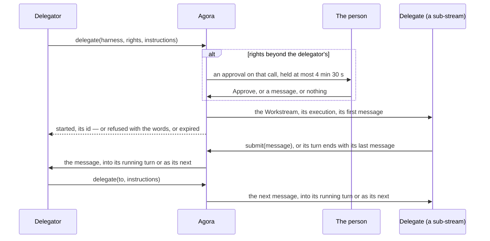

# Delegation

Contract to implement: an agent hands work to another agent through Agora's MCP server (`mcp.md`). A
delegate is a sub-stream of its delegator's Workstream, and the two speak by one gesture: a message
written in the other's Workstream. `delegate` writes in the delegate's; `submit` in the delegator's,
and a turn ended with no `submit` submits the delegate's last message.

**Nobody waits: a call answers as soon as its message is accepted, and the message goes as any message
written in that Workstream goes, the person's included: into the running turn when its agent can take
it there, as the next turn otherwise (`log.md`, "Messages during a turn"). Agora carries the words, whole,
and decides nothing about them: the delegator reads them, and writes again if it wants more.**

## A delegation

| Element | Rule |
| --- | --- |
| The delegator | The execution that calls `delegate` (`mcp.md`, "The path"), and its Workstream. |
| The delegate | A new Workstream, a sub-stream of the delegator's: the same person, one level deeper. Its execution: the pool of the `harness` named, the delegator's harness by default; `model` and `effort` as the pool offers them, its defaults otherwise; the rights given (`rights`), none by default, and Agora's own `agora:submit`; the delegator's lease and turn duration. Its title: the first line of `instructions`. |
| Started | Once the delegate's Workstream exists and its Create is accepted. Its first message waits there until its Session opens. |
| Depth | A delegate sits at most three levels below the person's Workstream: a delegator at depth 3 is refused, `depth_exceeded`. |
| At once | At most three of a delegator's delegates awaiting approval or working: another is refused, `too_many_delegates`. |
| Rights | Each right given must be offered (`credentials.md`, "Offered profiles"; `profile_not_offered`). When every one is covered by one of the delegator execution's own profiles — as an offered profile covers a narrower one —, the delegate starts at once; otherwise the call waits for the person ("Approval"). |
| States | `awaiting approval`; `working`: its Session opening, a turn running or a message waiting; `idle`: its last turn done; `failed`: its last turn failed, or its execution failed or was lost; `cancelled`: its last turn cancelled, or the person stopped it. A call refused or expired starts no delegate. |
| The handle | The delegate's Workstream id: what `to`, `read` and `search` take. |
| Who stops one | The person, from the delegate's own Workstream (Stop). An agent has no tool for it. |

## Messages

| Element | Rule |
| --- | --- |
| From the delegator | `delegate`: `instructions` is the delegate's first message; answered `started <id> · <title>`. With `to`, one of its delegates — then only `instructions` and `output_schema` —: its next message, whatever it is doing; answered `sent <id> · <title>`. `not_a_delegate`: a Workstream that is not one of its delegates. `delegate_stopped`: one the person stopped. |
| From the delegate | `submit`: `message`, the words, written in its delegator's Workstream; answered `sent`. As many times as it has something to say: a result, a question, news. A turn holding a message that is not the person's, done with no `submit` in it, submits its last message: the same message, whole. |
| A message | A Write of Agora's, with `mayWait` as the client's (`log.md`, "Commands"). Its prompt: a first text block, Agora's line saying who writes, marked `_meta` `agora.bretagne.dev/from` — its value `{ workstream, as }`, `as` being `delegator`, `delegate` or `agora`, with the `output_schema` a delegator gave and the `turn` a delegate wrote in —, then the words, whole: nothing summarised, nothing cut, up to a line's limit (`log.md`, "ACP lines"). |
| Agora's line | To a delegate: `From your delegator <id>, an agent, not the person. It receives your last message:`. To a delegator: `From your delegate <id> "<title>", not the person:`. |
| Its way | That of any message (`log.md`, "Messages during a turn"): in order, into the running turn or as the next, the person able to retract it while it waits. Nothing refuses it: it waits while its Workstream cannot take it, and a Workstream whose execution has ended is continued first, unless the person stopped it. |
| What it is worth | Agora keeps no verdict and no outcome. The delegator reads, and answers with `to` when it wants something else. |

## What Agora writes

A delegator is told what its delegate cannot tell it, by the same gesture: a message in its Workstream,
`as` `agora`: `From Agora, not the person: your delegate <id> "<title>"`, then what happened.

| When | The message says |
| --- | --- |
| A delegate's turn no person started is done with no `submit` and no message | It ended its turn with nothing to say. |
| A delegate's turn fails, its Session does not open, or its execution is lost | What happened. |
| The person stops a delegate, or cancels its turn | That the person did. |

Each, and a last message submitted, is written once, a restart included.

## Typed results

| Element | Rule |
| --- | --- |
| `output_schema` | Optional, with `delegate` or `to`. A JSON Schema whose root is an object, using only `type`, `properties`, `required`, `items`, `enum`, `description`, `additionalProperties`: anything else is refused, `invalid_schema`. Agora's line recalls it: `Give submit a result of this shape:`, then the schema. The mark carries it too. |
| `submit` | Listed to every delegate from its start: `message`, and `result`, an object. When its delegator's last message gave a schema, `result` is required and checked: a call that does not fit is a tool error naming the mismatch, and nothing is written. A `result` is written in the message as JSON. A turn with no `submit` submits its last message all the same: its delegator reads it. |

## Approval

| Element | Rule |
| --- | --- |
| The gate | Agora holds the call: nothing starts, the call stays open. It asks the person in the delegator's Workstream with an Ask of kind `approval` (`log.md`, "Commands"): its title the delegate's; its text the proposal — harness, model, effort, the rights beyond the delegator's, the instructions, the schema if any —; one option, Approve (`allow_once`); the tool line it gates when Agora can match it ("Matching"); its expiry, 4 min 30 s on. |
| Approve | The Answer: the delegate starts; the call answers `started`. |
| Writing | A Write of the person's in the delegator's Workstream while the approval is pending is its refusal, accepted whatever the turn: no prompt is sent, the approval is answered with the words, and the call answers `refused` with them. |
| No answer | At its expiry, the call answers `expired` and the approval is marked `expired`. |
| A restart | An approval whose call ended with the server is marked `expired` as the server starts: no call is left to start anything. |
| For that call alone | An approval starts that delegate, that once; the next call beyond the delegator's rights asks again. |
| One at a time | A call needing approval while another approval of the delegator's Workstream waits is refused, `approval_pending`. |
| The call kept open | A `delegate` call answers in an SSE stream: while Agora holds it, a progress notification every 30 s, then the call's answer (`mcp.md`, "The path"). |
| The delegator's turn | While an approval waits, the turn's clock stops (`executions.md`, "The deadline"). |
| Matching | The approval names the tool line it gates. Claude Code: the delegator's tool line whose `toolCallId` is the call's `_meta` `claudecode/toolUseId`. The others: the delegator's last tool line still running whose title names `delegate` and whose `rawInput` equals the call's arguments. Looked for up to 2 s, a harness giving its line just after its call. Without a match, it names none. |

## Acceptance cases

| ID | Case | Expected |
| --- | --- | --- |
| D1 | `delegate` within the delegator's rights | `started` and the id at once; a sub-stream one level below the delegator's Workstream, on the pool named; the instructions its first message, marked as its delegator's. |
| D5 | A delegator at depth 3; a delegator with three delegates working | `depth_exceeded`; `too_many_delegates`; no Workstream created. |
| D6 | Rights beyond the delegator's; Approve | The call held; an approval in the delegator's Workstream, one option; after Approve, `started`. |
| D7 | The person writes while the approval waits | The call answers `refused` with the words; no prompt sent; no delegate. |
| D8 | No answer | `expired` at 4 min 30 s; a progress notification every 30 s before; the delegator's turn deadline pushed back by the wait. |
| D9 | Another call needing approval while one waits | `approval_pending`. |
| D15 | Live, each harness — Claude Code, Codex, opencode — given `agora:delegate`, delegating a typed task within its rights | `started`; the delegate submits; its message reaches the delegator, which uses the result. |
| D16 | Live, each harness calling `delegate` beyond its rights | The approval names the delegator's `delegate` tool line, by its id on Claude Code and by its arguments on the others. |
| D17 | A restart while an approval waits, in a delegator with no delegate yet | The approval marked `expired` at start. |
| D18 | A delegate's `submit`, its delegator free | `sent`; a turn of the delegator's, its prompt Agora's line then the words; its `user` element `from` the delegate, `as` `delegate`, without the line. |
| D19 | A `submit` of 100,000 characters | The delegator's prompt holds them all. |
| D20 | Two delegates' `submit`, then another from the first, while the delegator's turn runs, its agent taking messages into a turn | `sent` each time; one `_session/steering` each, in the order sent; three `steered` `user` elements in that turn, each `from` its delegate; no second turn. |
| D30 | The same, its agent not taking them | `sent` each time; no turn until that one ends; then three turns, one each, in the order sent. |
| D21 | `to` a delegate whose turn runs; whose last turn is done; whose execution has ended | `sent` each time; into that turn, as any message; written at once; its execution continued, then written. |
| D22 | A `submit` to a delegator whose execution has ended; whom the person stopped | Continued, then a turn; waiting, no Create, until the person's next one. |
| D23 | `to` a delegate the person stopped; a Workstream that is not the delegator's delegate | `delegate_stopped`; `not_a_delegate`. |
| D24 | `output_schema` with `delegate`; `submit` a mismatch, then a fit | The delegate's first prompt recalls the schema; a tool error naming the mismatch, nothing written; then `sent`, the delegator's prompt holding the result as JSON. |
| D25 | `output_schema` first given with `to` | `submit`, listed since the delegate's Session opened, checks `result` against it. |
| D26 | A delegate's turn its delegator started ends with no `submit`; one with `submit`; one the person started; one the person started, a `to` sent into it; one with no `submit` and no message | Its last message whole in the delegator's Workstream, `as` `delegate`, as a `submit` gives it; nothing more; nothing; its last message, as the first; a message `as` `agora` saying so. |
| D27 | A delegate's turn fails; its Session does not open; its execution is lost; the person stops it | Each time one message `as` `agora` in the delegator's Workstream, naming the delegate and what happened. |
| D28 | A restart once a delegate's turn is done, before its last message was submitted | Submitted after the restart, once. |
| D29 | Live, each harness, a delegate asked for a report of at least 30,000 characters | The delegator's prompt holds it whole, its agent sending no further `to` for the rest. |
| D31 | Live, Claude Code and Codex, a delegator running a long command as its delegate submits a word | The message waits for the command; `injected` in that turn; the delegator's answer holds the word. |

## To be specified

- Files between agents: a message carries text; a file has no way from one sandbox to another, and
  Agora has no persistent store for it.
- A team as a composition of delegations: one approval for a chain of runs.
- An agent stopping its own delegates.
