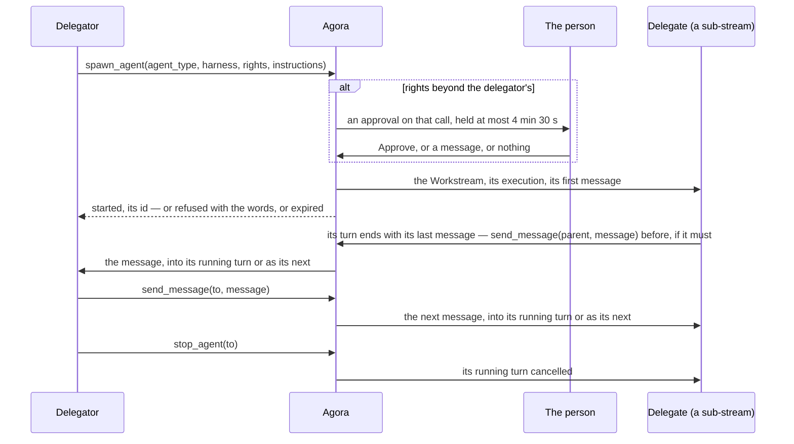

# Delegation

Contract to implement: an agent hands work to another agent through Agora's MCP server (`mcp.md`), by
the gestures the harnesses give their own sub-agents: `spawn_agent`, `send_message`, `stop_agent`,
`list_agents`. A delegate is a sub-stream of its delegator's Workstream, and the two speak by one
gesture: a message written in the other's Workstream. `spawn_agent` and `send_message` write in the
delegate's; a delegate's turn, once done, sends its last message to its delegator's, and `send_message`
to `parent` writes there before that.

**Nobody waits: a call answers as soon as its message is accepted, and the message goes as any message
written in that Workstream goes, the person's included: into the running turn when its agent can take
it there, as the next turn otherwise (`log.md`, "Messages during a turn"). Agora carries the words, whole,
and decides nothing about them: the delegator reads them, and writes again if it wants more.**

## A delegation

| Element | Rule |
| --- | --- |
| The delegator | The execution that calls `spawn_agent` (`mcp.md`, "The path"), and its Workstream. |
| The delegate | A new Workstream, a sub-stream of the delegator's: the same person, one level deeper. Its execution: the pool of the `harness` named, the delegator's harness by default; `model` and `effort` as the pool offers them, its defaults otherwise, the effort sent under the id the pool gives it, in its defaults or in what its last Session offered — `effort`, or `reasoning_effort` —, as the flows send it (`flows.md`, "Role cards"); the rights given (`rights`), none by default, and Agora's own `agora:submit`; the delegator's lease and turn duration. Its title: the first line of `instructions`. |
| Its role | `agent_type`, when given, names one of Agora's roles: a role card (`flows.md`, "Role cards"), as the harnesses name an agent's type when they start a sub-agent of their own. The card gives the delegate its persona, said once, in Agora's line of its first message ("Messages"), and what it works with by default: its harness, unless `harness` names one; its model and its effort, on that harness alone — on another, that pool's defaults —, unless `model` or `effort` name them. A card gives no right. `unknown_agent_type`: a name that is no card's; nothing starts. Without `agent_type`, or with a null one, a delegate has no role. |
| Started | Once the delegate's Workstream exists and its Create is accepted. Its first message waits there until its Session opens. |
| Depth | A delegate sits at most three levels below the person's Workstream: a delegator at depth 3 is refused, `depth_exceeded`. |
| At once | At most three of a delegator's delegates awaiting approval or working: another is refused, `too_many_delegates`. |
| Rights | Each right given must be offered (`credentials.md`, "Offered profiles"; `profile_not_offered`). When every one is covered by one of the delegator execution's own profiles — as an offered profile covers a narrower one —, the delegate starts at once; otherwise the call waits for the person ("Approval"). |
| States | `awaiting approval`; `working`: its Session opening, a turn running or a message waiting; `idle`: its last turn done; `failed`: its last turn failed, or its execution failed, was lost or ended with no Session; `cancelled`: its last turn cancelled, or the person stopped it. A call refused or expired starts no delegate. |
| The handle | The delegate's Workstream id: what `send_message`, `stop_agent`, `read` and `search` take. |
| Who stops one | The person, from the delegate's own Workstream: Stop, after which no agent reaches it (`delegate_stopped`), or Cancel on its turn. Its delegator, by `stop_agent`: its running turn alone ("Stopping and listing"). |

## Messages

| Element | Rule |
| --- | --- |
| From the delegator | `spawn_agent`: `instructions` is the delegate's first message; answered `started <id> · <title>`. `send_message`, `to` one of its delegates: `message` is its next message, whatever it is doing; answered `sent <id> · <title>`. `not_a_delegate`: a Workstream that is not one of its delegates. `delegate_stopped`: one the person stopped. `too_many_exchanges`: ten `send_message` to that delegate since the person last wrote, in its Workstream or its delegator's; the person's next message there opens ten more. |
| From the delegate | A turn holding a message that is not the person's, once done, sends its last message to its delegator: the same message, whole. Before that, `send_message`, `to` `parent` or its delegator's id: `message`, written in its delegator's Workstream — a question, news —; answered `sent`, as many times as it has something to say; its turn's last message goes all the same. `no_delegator`: `parent` from an execution that is no delegate. A turn of the earlier contract in which the delegate called `submit` — a message of its in its delegator's Workstream marked with that `turn` — sends nothing more, as then. |
| A message | A Write of Agora's, with `mayWait` as the client's (`log.md`, "Commands"). Its prompt: a first text block, Agora's line saying who writes, marked `_meta` `agora.bretagne.dev/from` — its value `{ workstream, as }`, `as` being `delegator`, `delegate` or `agora`, a delegate's last message with the `turn` it closes —, then the words, whole: nothing summarised, nothing cut, up to a line's limit (`log.md`, "ACP lines"). |
| Agora's line | To a delegate: `From your delegator <id>, an agent, not the person. It receives your last message:`. The first message of a delegate with a role, before that line and in the same block: `` From Agora, not the person: your role, `<role>`. ``, the card's persona, a line `---`. To a delegator: `From your delegate <id> "<title>", not the person:`. |
| Its way | That of any message (`log.md`, "Messages during a turn"): in order, into the running turn or as the next, the person able to retract it while it waits. Nothing refuses it: it waits while its Workstream cannot take it, and a Workstream whose execution has ended is continued first (`log.md`, same place). |
| What it is worth | Agora keeps no verdict and no outcome. The delegator reads, and answers with `send_message` when it wants something else. |

## What Agora writes

A delegator is told what its delegate cannot tell it, by the same gesture: a message in its Workstream,
`as` `agora`: Agora's line `From Agora, not the person:`, then `Your delegate <id> "<title>":` and what happened.

| When | The message says |
| --- | --- |
| A delegate's turn holding a message that is not the person's is done with no message | It ended its turn with nothing to say. |
| A delegate's turn fails, its Session does not open, or its execution is lost | What happened. |
| The person stops a delegate, or cancels its turn | That the person did. |

Each, and a delegate's last message, is written once, a restart included. A delegator that stops its
delegate itself is written nothing: its call's answer says it.

## Stopping and listing

| Element | Rule |
| --- | --- |
| `stop_agent` | `to` one of the caller's delegates. Agora cancels the delegate's turn in progress or uncertain, by a Cancel of its own (`log.md`, "Commands"), its body's `from` naming the delegator's Workstream, `as` `delegator`; as after the person's: its pending permissions answered `cancelled`, what waits there kept waiting until the next message written (`log.md`, "Messages during a turn"). Answered `stopped <id> · <title>` once that Cancel is accepted. With no such turn, nothing is done: `no turn to stop <id> · <title>`; a turn ended as its Cancel came, the next is looked for once. `not_a_delegate`, `delegate_stopped`: as for `send_message`, the person's Stop coming meanwhile included; any other refusal of the Cancel is the call's (`log.md`, "Commands"). |
| After it | From its Cancel on, the delegate counts no more among the three at once; once its agent has answered, it is `cancelled`. It stays its delegator's: `send_message` reaches it, and starts its next turn. Its own delegates go on, and their last messages reach it as any. |
| `list_agents` | No parameter. The caller's delegates, the most recently changed first, one line each: `<id> · <title> · <state>`, its state as "A delegation" names it — `working`, `idle`, `failed`, `cancelled`. With none: `no delegate`. A call still waiting for its approval has started no delegate, and is not listed. |

## Approval

| Element | Rule |
| --- | --- |
| The gate | Agora holds the call: nothing starts, the call stays open. It asks the person in the delegator's Workstream with an Ask of kind `approval` (`log.md`, "Commands"): its title the delegate's; its text the proposal — the delegate's role when it has one, harness, model, effort, the rights beyond the delegator's, the instructions —; one option, Approve (`allow_once`); the tool line it gates when Agora can match it ("Matching"); its expiry, 4 min 30 s on. |
| Approve | The Answer: the delegate starts; the call answers `started`. |
| Writing | A Write of the person's in the delegator's Workstream while the approval is pending is its refusal, accepted whatever the turn: no prompt is sent, the approval is answered with the words, and the call answers `refused` with them. |
| No answer | At its expiry, the call answers `expired` and the approval is marked `expired`. |
| A restart | An approval whose call ended with the server is marked `expired` as the server starts: no call is left to start anything. |
| For that call alone | An approval starts that delegate, that once; the next call beyond the delegator's rights asks again. |
| One at a time | A call needing approval while another approval of the delegator's Workstream waits is refused, `approval_pending`. |
| The call kept open | A `spawn_agent` call answers in an SSE stream: while Agora holds it, a progress notification every 30 s, then the call's answer (`mcp.md`, "The path"). |
| The delegator's turn | While an approval waits, the turn's clock stops (`executions.md`, "The deadline"). |
| Matching | The approval names the tool line it gates. Claude Code: the delegator's tool line whose `toolCallId` is the call's `_meta` `claudecode/toolUseId`. The others: the delegator's last tool line still running whose title names `spawn_agent` and whose `rawInput` equals the call's arguments. Looked for up to 2 s, a harness giving its line just after its call. Without a match, it names none. |

## Acceptance cases

| ID | Case | Expected |
| --- | --- | --- |
| D1 | `spawn_agent` within the delegator's rights | `started` and the id at once; a sub-stream one level below the delegator's Workstream, on the pool named; the instructions its first message, marked as its delegator's. |
| D5 | A delegator at depth 3; a delegator with three delegates working; four calls at once | `depth_exceeded`; `too_many_delegates`; no Workstream created; three started, one `too_many_delegates`. |
| D6 | Rights beyond the delegator's; Approve | The call held; an approval in the delegator's Workstream, one option; after Approve, `started`. |
| D7 | The person writes while the approval waits | The call answers `refused` with the words; no prompt sent; no delegate. |
| D8 | No answer | `expired` at 4 min 30 s; a progress notification every 30 s before; the delegator's turn deadline pushed back by the wait. |
| D9 | Another call needing approval while one waits | `approval_pending`. |
| D15 | Live, each harness — Claude Code, Codex, opencode — given `agora:delegate`, delegating a task within its rights | `started`; the delegate answers; its last message reaches the delegator, which uses it. |
| D16 | Live, each harness calling `spawn_agent` beyond its rights | The approval names the delegator's `spawn_agent` tool line, by its id on Claude Code and by its arguments on the others. |
| D17 | A restart while an approval waits, in a delegator with no delegate yet | The approval marked `expired` at start. |
| D18 | A delegate's `send_message` to `parent`, its delegator free | `sent`; a turn of the delegator's, its prompt Agora's line then the words; its `user` element `from` the delegate, `as` `delegate`, without the line. |
| D19 | A delegate's last message of 100,000 characters | The delegator's prompt holds them all. |
| D20 | Two delegates' `send_message` to `parent`, then another from the first, while the delegator's turn runs, its agent taking messages into a turn | `sent` each time; one `_session/steering` each, in the order sent; three `steered` `user` elements in that turn, each `from` its delegate; no second turn. |
| D30 | The same, its agent not taking them | `sent` each time; no turn until that one ends; then three turns, one each, in the order sent. |
| D21 | `send_message` to a delegate whose turn runs; whose last turn is done; whose execution has ended | `sent` each time; into that turn, as any message; written at once; its execution continued, then written. |
| D22 | A delegate's last message to a delegator whose execution has ended; whom the person stopped | Continued, then a turn; waiting, no Create, until the person's next one. |
| D23 | `send_message` to a delegate the person stopped; to a Workstream that is not the caller's delegate | `delegate_stopped`; `not_a_delegate`. |
| D26 | A delegate's turn its delegator started, done; one with a `send_message` to `parent` in it; one the person started; one the person started, a `send_message` sent into it; one with no message | Its last message whole in the delegator's Workstream, `as` `delegate`; that message, then its last message; nothing; its last message, as the first; a message `as` `agora` saying so. |
| D27 | A delegate's turn fails; its Session does not open; its execution is lost; the person stops it | Each time one message `as` `agora` in the delegator's Workstream, naming the delegate and what happened. |
| D28 | A restart once a delegate's turn is done, before its last message was sent | Sent after the restart, once. |
| D29 | Live, each harness, a delegate asked for a report of at least 30,000 characters | The delegator's prompt holds it whole, its agent sending no further `send_message` for the rest. |
| D31 | Live, Claude Code and Codex, a delegator running a long command as its delegate's last message brings a value only the delegate can know | The message waits for the command; its `_session/steering` after the command closed, `injected`; one turn; the delegator's answer holds the value. |
| D32 | An agent titling itself with Agora's line | The Workstream's title stays the first line of its instructions, or its agent's last other title. |
| D33 | A delegate that delegates: its own delegate's last message, with its own execution running; with its own execution ended | A turn of the middle one, its last message then in the top one's Workstream; the same once it is continued, its last message going up all the same. |
| D34 | A restart with a message of Agora's waiting and its Workstream's execution ended | Continued after the restart; the message sent once. |
| D35 | A delegate's execution ending while Agora is down | After the restart, one message `as` `agora` in its delegator's Workstream. |
| D36 | A delegate of an earlier delegation, its turns and its execution as that engine left them, at start | Nothing written to its delegator; a later `send_message` followed as any. |
| D37 | A delegate that cannot start; a `send_message` once its execution ended; one while it still holds its claim | One message `as` `agora`; no further Create by itself, its Workstream `failed`; one more Create; one more Create once it ends. |
| D38 | A Cancel with a message of Agora's waiting, then its execution's end | No Create; the next message: a Create, then both, in order. |
| D39 | A delegate continued with a catch-up, its anchor lost | Its last message in its delegator's Workstream, as any. |
| D40 | A delegate whose Pod never starts, its execution ending with no failure recorded | One message `as` `agora`; `failed`; no Create. |
| D41 | The person cancels a delegate's turn, a `send_message` waiting | `cancelled`; it counts no more among the three at once. |
| D42 | `send_message` naming a delegate in capitals | `sent`; its last message written once. |
| D43 | A delegate whose Session opens and never takes its message, an opening setting never answered | No further Create by itself; a `send_message`: one more. |
| D44 | A message of Agora's saying a delegate's end, refused for a moment | Written at the next beat, once. |
| D45 | Ten `send_message` to a delegate, then an eleventh; its own to `parent`; the person writing in the delegator's Workstream, then the same; the person writing in the delegate's | `sent` ten times, then `too_many_exchanges`, nothing written; `sent`; the same; `sent`. |
| D46 | `stop_agent` on a delegate whose turn runs, a permission pending in it; then `send_message` to it | `stopped <id> · <title>`; one `session/cancel` for that turn, its Cancel naming the delegator; the permission answered `cancelled`; the delegate `cancelled`, counting no more among the three at once — from its Cancel on, before its agent has answered —; no message in the delegator's Workstream; then `sent`, and a turn of the delegate's, whose Cancel by the person is told as the person's. |
| D47 | `stop_agent` on a delegate with no turn in progress; on one the person stopped; on a Workstream that is not the caller's delegate | `no turn to stop <id> · <title>`, no line sent; `delegate_stopped`; `not_a_delegate`. |
| D48 | `stop_agent` on a delegate whose own delegate works | Its turn `cancelled`; its own delegate's turn goes on, and that one's last message, once done, is a turn of the stopped delegate's. |
| D49 | `list_agents` with no delegate; with three — one working, one idle, one the person stopped —, a call waiting for its approval beside them | `no delegate`; three lines, the most recently changed first, each `<id> · <title> · <state>`: `working`, `idle`, `cancelled`; the waiting call in none. |
| D50 | A delegate's `send_message` to its delegator's id; to another delegate of its delegator's, and `stop_agent` on it, holding `agora:delegate` itself; a delegator's to its delegate's own delegate; `parent` from an execution that is no delegate | `sent`, as to `parent`; `not_a_delegate` each time, nothing written, no turn cancelled; `no_delegator`. |
| D51 | Live, each harness — Claude Code, Codex, opencode — given `agora:delegate`: starting a delegate on a long command, listing, stopping it, then writing to it | Each calls Agora's `spawn_agent`, `list_agents`, `stop_agent` and `send_message`, and none of its harness's own sub-agent tools; the list names the delegate `working`; `stopped`; the delegate answers the message. |
| D52 | A turn of the earlier contract, done with a `submit` in it; then the server's start | Nothing more written to its delegator, at its end or at the start. |
| D53 | `spawn_agent` with `agent_type`, a role of another harness than the delegator's, with a model and an effort; then a `send_message`; the agent titling itself with the first line it read | `started`; the delegate on that harness's pool, the role's model and effort its opening settings, its `delegation.started` naming the role; its first prompt: one block of Agora's — the role's line, the persona, `---`, the delegator's line —, then the instructions; its `user` element and its title the instructions alone, that title kept; the next message opening on the delegator's line alone. |
| D54 | A role with `harness` naming another; with `model` given; a role whose card names no model and no effort; no `agent_type` | The pool named, none of the role's settings, its persona all the same; that model, the role's effort; its pool's own settings; the delegator's harness, the delegator's line alone. |
| D55 | `agent_type` naming no role; not a string; null; with no role held; a role, rights beyond the delegator's | `unknown_agent_type`; `invalid_query` naming it; a delegate with no role; `unknown_agent_type`; no Workstream created by a refusal; the approval's text opens on the role. |
| D56 | An effort, the call's then a role's, for a pool whose Sessions name it `reasoning_effort`; a role's, for a pool no Session has opened in, whose defaults name it so | The delegate's opening setting `reasoning_effort`, its Session set to that value. |
| D57 | Live, Claude Code delegating with `agent_type` `judge`, then with `sre`, each asked the name of its role | A delegate on Codex, then one on Claude Code: its card in Agora's line of its first prompt; its model and effort the card's — an effort its pool's default is not —, as its Session says them; its answer naming its role. |

## To be specified

- Files between agents: a message carries text; a file has no way from one sandbox to another, and
  Agora has no persistent store for it.
- A team as a composition of delegations: one approval for a chain of runs.
- A delegate stopped before its first turn has started: its message still goes.
- Stopping, with a delegate, its own delegates and the sub-agents its harness started.
- The delegate's thread saying who cancelled its turn.
- A result of a shape its delegator gives: asked for in the instructions and read as any message; nothing
  checks it.
- A delegate's role shown to the person: on its row, in its thread.
- A role's persona given again once its harness has compacted its first message away.
