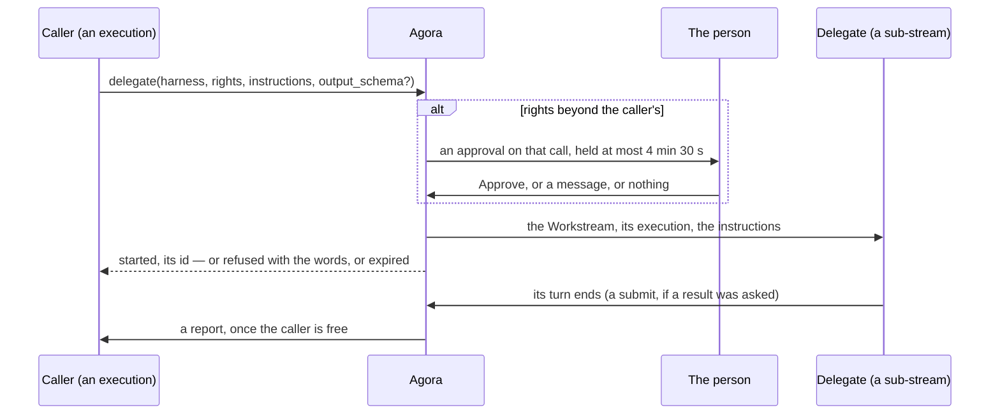

# Delegation

Contract to implement: an agent hands work to another agent through Agora's MCP server (`mcp.md`).
`delegate` starts a delegate — a sub-stream of the caller's Workstream (`log.md`, "Sub-streams") — or
continues one, and Agora writes the caller each outcome later, as a report. A call giving more rights
than the caller holds waits for the person, who approves it with one button or refuses it by writing.

**The caller never waits for the work: `delegate` answers once the delegate has started, and every
outcome comes back as a turn Agora writes once the caller is free. Approval is a gate on the call
itself, for that call alone.**

## A delegation

| Element | Rule |
| --- | --- |
| The caller | The execution that calls `delegate` (`mcp.md`, "The path"), and its Workstream. |
| The delegate | A new Workstream, a sub-stream of the caller's: the same person, one level deeper. Its execution: the pool of the `harness` named, the caller's harness by default; `model` and `effort` as the pool offers them, its defaults otherwise; the rights given (`rights`), none by default; the caller's lease and turn duration. Its first message: `instructions`, marked as its caller's; its title, their first line. |
| Started | Once the delegate's Workstream exists and its Create is accepted. Its instructions are written as soon as its Session opens; a Session that does not open fails the delegation. |
| Continuing | `to` names one of the caller's delegates — a sub-stream of the caller's Workstream. `instructions` is its next message (`delegation.continued`), written once it can take one (`delegate_busy` while a turn runs or a message waits); its execution continued first if it has ended (`log.md`, "Continuing"). With `to`, only `instructions` and `output_schema` are given. |
| Depth | A delegate sits at most three levels below the person's Workstream: a caller at depth 3 is refused, `depth_exceeded`. |
| At once | At most three of a caller's delegates awaiting approval or working: another is refused, `too_many_delegates`. |
| Rights | Each right given must be offered (`credentials.md`, "Offered profiles"; `profile_not_offered`). When every one is covered by one of the caller execution's own profiles — as an offered profile covers a narrower one —, the delegate starts at once; otherwise the call waits for the person ("Approval"). |
| States | `awaiting approval`, `working`, then `completed`, `failed` or `cancelled`. A call refused or expired starts no delegate. |
| The handle | The delegate's Workstream id: what `to`, `read` and `search` take. |
| Who stops one | The person, from the delegate's own Workstream (Stop): its delegation `cancelled`. An agent has no tool for it. |

## Approval

| Element | Rule |
| --- | --- |
| The gate | Agora holds the call: nothing starts, the call stays open. It asks the person in the caller's Workstream with an Ask of kind `approval` (`log.md`, "Commands"): its title the delegate's; its text the proposal — harness, model, effort, the rights beyond the caller's, the instructions, the schema if any —; one option, Approve (`allow_once`); the tool line it gates when Agora can match it ("Matching"); its expiry, 4 min 30 s on. |
| Approve | The Answer: the delegate starts; the call answers `started`. |
| Writing | A Write in the caller's Workstream while the approval is pending is its refusal, accepted whatever the turn: no prompt is sent, the approval is answered with the words, and the call answers `refused` with them. |
| No answer | At its expiry, the call answers `expired` and the approval is marked `expired`. |
| For that call alone | An approval starts that delegate, that once; the next call beyond the caller's rights asks again. |
| One at a time | A call needing approval while another approval of the caller's Workstream waits is refused, `approval_pending`. |
| The call kept open | A `delegate` call answers in an SSE stream: while Agora holds it, a progress notification every 30 s, then the call's answer (`mcp.md`, "The path"). |
| The caller's turn | While an approval waits, the turn's clock stops (`executions.md`, "The deadline"). |
| Matching | The approval names the tool line it gates. Claude Code: the caller's tool line whose `toolCallId` is the call's `_meta` `claudecode/toolUseId`. The others: the caller's last tool line still running whose title names `delegate` and whose `rawInput` equals the call's arguments. Without a match, it names none. |

## Typed results

| Element | Rule |
| --- | --- |
| `output_schema` | Optional. A JSON Schema whose root is an object, using only `type`, `properties`, `required`, `items`, `enum`, `description`, `additionalProperties`: anything else is refused, `invalid_schema`. |
| `submit` | The delegate's `agora` server lists `submit`, its input that schema (`mcp.md`, "Tools"). A call that does not fit is a tool error naming the mismatch; one that fits is the result — recorded in the delegate's log, answered `submitted`. A second call replaces the first. |
| No result | A delegate whose turn ends without a result is written once: "You were asked for a result: call submit with it." Its next turn ending without one, the delegation completes with no result. |

## Reports

| Element | Rule |
| --- | --- |
| An outcome | Each turn a delegation gives its delegate ends with an outcome: `completed`, with the typed result or the delegate's last message; `failed`, with its reason; `cancelled`, stopped by the person or its execution lost. |
| Delivery | A Write to the caller's Workstream once the caller is free: no turn running or uncertain, no permission, question or approval pending. A message of the person's accepted first goes first; the report waits for its turn to end. If the caller's execution has ended, Agora continues it first. |
| Together | Every outcome not yet reported goes in one report. |
| Its text | One prompt block marked `_meta` `agora.bretagne.dev/report` (`log.md`, "Elements"): "From Agora, not the person:", then for each outcome the delegate's id and title, its state, its result as JSON or its last message cut to 2,000 characters, and "read <id> for the rest". |
| Once | An outcome is reported once; after a restart, those not yet reported are found again from the log. |

## Acceptance cases

| ID | Case | Expected |
| --- | --- | --- |
| D1 | `delegate` within the caller's rights | `started` and the id at once; a sub-stream one level below the caller's Workstream, on the pool named; the instructions its first message, marked as its caller's. |
| D2 | The delegate's turn ends | Once the caller is free, a report in its Workstream, marked as Agora's: the id, `completed`, the delegate's last message. |
| D3 | Two delegates ending while the caller's turn runs | One report after that turn, both outcomes. |
| D4 | The person writes as the caller turns free, a report pending | The person's message first; the report after its turn. |
| D5 | A caller at depth 3; a caller with three delegates working | `depth_exceeded`; `too_many_delegates`; no Workstream created. |
| D6 | Rights beyond the caller's; Approve | The call held; an approval in the caller's Workstream, one option; after Approve, `started`. |
| D7 | The person writes while the approval waits | The call answers `refused` with the words; no prompt sent; no delegate. |
| D8 | No answer | `expired` at 4 min 30 s; a progress notification every 30 s before; the caller's turn deadline pushed back by the wait. |
| D9 | Another call needing approval while one waits | `approval_pending`. |
| D10 | `output_schema`; the delegate submits a mismatch, then a fit | A tool error naming the mismatch, then `submitted`; the report carries the result as JSON. |
| D11 | A delegate asked for a result ends without one | Written once; its next turn ending without one, `completed` with no result. |
| D12 | `to` a delegate whose turn runs; whose turn ended; whose execution ended | `delegate_busy`; the instructions written; the execution continued, then written. |
| D13 | The caller's execution ended before the report | Continued, then the report written. |
| D14 | A restart with an outcome not yet reported | Reported after the restart, once. |
| D15 | Live, each harness — Claude Code, Codex, opencode — given `agora:delegate`, delegating a typed task within its rights | `started`; the delegate submits; the report reaches the caller, which uses the result. |
| D16 | Live, each harness calling `delegate` beyond its rights | The approval names the caller's `delegate` tool line, by its id on Claude Code and by its arguments on the others. |

## To be specified

- A team as a composition of delegations: one approval for a chain of runs.
- An agent stopping its own delegates.
