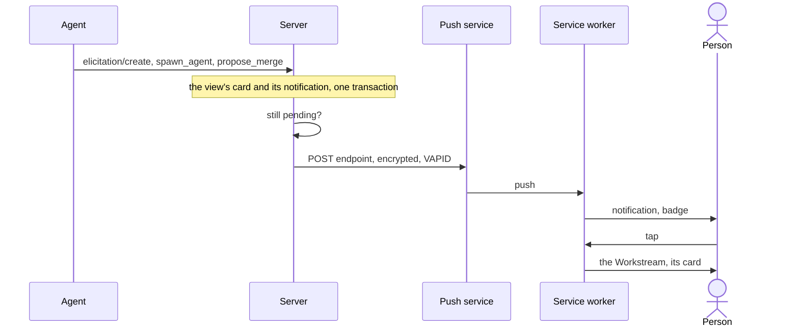

# Notifications

Contract to implement: a notification on the person's phone and browsers when a card waits on them.
Written against the Push API and the Notifications API (W3C), Web Push (RFC 8030), its message
encryption (RFC 8291, `aes128gcm`) and VAPID (RFC 8292); Safari's declarative Web Push messages
(Safari 18.4); `web-push` 4.0.0. On iOS and iPadOS 16.4 and later, a web app added to the Home Screen.

**Three cards, once each, nothing else. A form shown to the person, an approval or a merge card
becomes pending; in the same transaction, Agora writes what to send; it sends it to every subscription
of the person's, unless the card is no longer pending by then. The payload is light: the Workstream's
title, the card's kind, its first line.**

## What notifies

A card notifies the owner of its Workstream — a sub-stream's, its root's owner (`log.md`, "Sub-streams") —
when it becomes pending for the person.

| Card | `kind` | Pending when | For the person |
| --- | --- | --- | --- |
| A form | `form` | The Workstream view's `request` takes the position of an `elicitation/create` (`log.md`, "The Workstream view"). | Unless its Workstream is a delegate's — its view carries `delegation` —: that form goes to its delegator (`delegation.md`, "Requests"). A native sub-stream's form is the person's, under a delegate included. |
| An approval | `approval` | The view's `question` takes an Ask of Agora's, `kind` `approval` (`delegation.md`, "Approval"). | Always, while its `expiresAt` is ahead. |
| A merge card | `merge` | The view's `question` takes an Ask of Agora's, `kind` `merge` (`merge.md`). | Always. |

| Rule | Detail |
| --- | --- |
| Once | One notification per Workstream and card position, written in the transaction that makes the card pending (`push_notifications`); the same position again — a replay, a rebuild, a restart — writes none. |
| Not notified | A permission (`session/request_permission`); an Ask of no `kind`; a form Agora declines itself (`log.md`, "Requests"); a turn's end, an execution's failure, a message. A rebuild of the projection and the back-filling of rows at start write none. |
| Still pending | Read again before each attempt to send: a card answered, refused, expired, cancelled, or no longer the view's `request` or `question`, is `dropped`, nothing more sent for it. |

## Subscriptions

One per browser that turned notifications on, stored for its owner (`push_subscriptions`): its
`endpoint`, its keys `p256dh` and `auth`.

| Route | Answer |
| --- | --- |
| `GET /api/push` | `key`: the VAPID public key, base64url. 404 `push_unavailable` when the server has none ("Configuration"). |
| `POST /api/push/subscriptions` | Body: a `PushSubscription`'s JSON — `endpoint`, `keys.p256dh`, `keys.auth`. Stored for the caller's owner; an endpoint already stored gets the new keys and owner. 200 `{}`. |
| `DELETE /api/push/subscriptions` | Body: `endpoint`. The caller's subscription with that endpoint removed. 200 `{}`, whether one was removed or not. |
| `GET /api/push/pending` | `cards`: the caller's cards pending for the person ("What notifies"), each `workstream`, `position`, `kind`, by position. |

| Refusal | When |
| --- | --- |
| 400 `invalid_subscription` | An `endpoint` that is not an `https` URL on port 443 of a push service — `web.push.apple.com`, `fcm.googleapis.com`, `updates.push.services.mozilla.com`, a host under `notify.windows.com` —, or over 1,024 characters; a `p256dh` that is not 65 bytes base64url, starting `0x04`; an `auth` that is not 16 bytes base64url. Nothing stored. |
| 409 `too_many_subscriptions` | A new endpoint for an owner holding 10. |
| 404 `push_unavailable` | Every route `/api/push…`, when the server has no VAPID key. |

The caller's owner is what its identity proves (`log.md`, "Identity"); with no identity, the body's or the
query's `owner`, as for a Create. A subscription receives its owner's cards alone; `GET /api/push/pending`
lists the caller's alone.

## The message

The payload is a declarative Web Push message, UTF-8 JSON, at most 3,000 bytes before encryption.

| Member | Value |
| --- | --- |
| `web_push` | `8030`. |
| `notification.title` | The Workstream's `title` (`log.md`, "The Workstream view"). |
| `notification.body` | The kind, ` · `, then the card's first line: `Question · ` and the form's `message`; `Approval · ` and the Ask's `title`; `Merge · ` and the Ask's `title`, the pull request's. Its first line alone, at most 120 code points, the 120th an ellipsis when it is cut. |
| `notification.navigate` | `PUBLIC_URL`, then `/w/` and the Workstream's id: the client's address of that Workstream. |
| `notification.tag` | The Workstream's id: a newer notification of the same Workstream replaces the one shown. |
| `notification.data` | `workstream`, `position`, `kind`. |
| `notification.app_badge` | The number of the owner's cards pending for the person, this one included, as a decimal string. |

| Header | Value |
| --- | --- |
| `TTL` | `86400` for a form and a merge card; for an approval, the whole seconds left until its `expiresAt`. |
| `Urgency` | `high`. |
| `Topic` | The Workstream's id without its hyphens: a push of the same Workstream not yet delivered is replaced. |
| `Content-Encoding` | `aes128gcm`, to the subscription's `p256dh` and `auth`. |
| `Authorization` | `vapid t=…, k=…`: a JWT signed ES256 with the VAPID private key, `aud` the endpoint's origin, `sub` `PUSH_SUBJECT`, `exp` 12 hours ahead at most. |

## Sending

| Rule | Detail |
| --- | --- |
| When | Once its transaction commits; at start, every notification not `sent` nor `dropped`. |
| To whom | Every subscription its owner holds when it is sent. None: `dropped`. |
| A request | One `POST` to the endpoint per subscription, from the server's Pod, not through Agora's gateway; 10 s at most. |
| 2xx | Delivered to that subscription. |
| 404, 410 | The subscription is gone: removed. |
| 429, 5xx, no answer | Tried again after 5 s, 30 s, 2 min, then every 10 min — after `Retry-After` when it says longer —, until the `TTL` has passed since it was written; then given up for that subscription. |
| Another 4xx | Given up for that subscription. |
| Its state | `pending` while a subscription may still be tried; then `sent`, or `dropped` ("What notifies", "Still pending"). |
| What is logged | The notification, the endpoint's host, the status. Never the endpoint's path, the keys, nor the payload. |

## The client

| Element | Rule |
| --- | --- |
| The service worker | `/sw.js`, scope `/`, served as the client's files are; registered at start wherever `navigator.serviceWorker` exists. |
| A push | The service worker shows the message's `notification` — `title`, `body`, `tag`, `data`, the icon `/icon-192.png` — and sets the badge to its `app_badge`. A payload that is not one of Agora's messages shows "Agora", nothing more. |
| A tap | The notification closes; a window of the client, focused, opens its Workstream — none open, a window opens at its `navigate`. |
| The switch | In the account (`assistant-ui.md`, "Accounts"): **Notifications**, on or off. Not shown when `GET /api/push` answers `push_unavailable`. |
| Not possible | No `PushManager`: on iOS outside the Home Screen, the item says "Add Agora to your Home Screen for notifications"; elsewhere it is not shown. Permission denied: "Notifications are blocked in this browser's settings". |
| On | On the tap: the permission asked, then `pushManager.subscribe` with `userVisibleOnly` true and the server's key, then the `POST`. At each start with the permission granted, the subscription posted again; one made with another key, replaced. |
| Off | `unsubscribe`, then the `DELETE`. |
| Opened | At start and each time the client becomes visible: `GET /api/push/pending`; each notification shown whose `workstream` and `position` it does not list is closed; the badge is set to the number of cards, cleared at zero. |

## Configuration

| Variable | Value |
| --- | --- |
| `PUSH_VAPID_PUBLIC_KEY`, `PUSH_VAPID_PRIVATE_KEY` | The VAPID key pair, P-256, base64url. |
| `PUSH_SUBJECT` | A `mailto:` or `https:` URL naming the operator. |
| `PUBLIC_URL` | The client's origin, `https://agora.bretagne.dev` in production. |

All four or none. None: nothing is written to send, every route `/api/push…` is `push_unavailable` — a
preview takes none (`preview.md`). Some without the others: the server does not start.

## Acceptance cases

| ID | Case | Expected |
| --- | --- | --- |
| N1 | Two subscriptions of the person's; its agent asks a form in a root Workstream | One notification `form`; one `POST` to each endpoint, `TTL` `86400`, `Urgency` `high`, `Topic` the id without hyphens; decrypted, `web_push` `8030`, the Workstream's title, `Question · ` and the form's message, `navigate` `PUBLIC_URL/w/<id>`, `tag` the id, `data` its Workstream, position and `form`, `app_badge` `1`; `sent`. |
| N2 | A delegate's agent asks a form; a native sub-agent of that delegate asks one; an agent asks a permission; Agora declines a form with a secret field | None; one, for the native sub-stream, to the person; none; none. |
| N3 | A `spawn_agent` waiting for approval; another answered before its notification is sent; another, the server held until past its `expiresAt` | One notification `approval`, `TTL` the seconds left to `expiresAt`, `Approval · ` and the Ask's title; `dropped`, nothing sent; `dropped`, nothing sent. |
| N4 | `propose_merge` on an open pull request | One notification `merge`, `Merge · ` and the pull request's title, `TTL` `86400`. |
| N5 | The server restarted between a card's commit and its sending; then after its sending; then a rebuild of the projection | Sent once, after the restart; nothing again; nothing again. |
| N6 | A form pending, then a second form of the same Session; the first answered | One notification for the first; the second's once it is the view's `request`, `Topic` the same, `app_badge` counting what is pending then. |
| N7 | Endpoints answering 201; 410; 404; 429 with `Retry-After: 60`; 500 then 201; 400 | Delivered; removed; removed; tried again after 60 s; tried again after 5 s, delivered; given up, the others delivered; nothing of the endpoint's path, keys or payload in the server's log. |
| N8 | `POST /api/push/subscriptions` with an `http` endpoint, another host, port 8443, a `p256dh` of 64 bytes, an `auth` of 8; the same endpoint twice; an eleventh endpoint; `DELETE` of it, then of an endpoint nobody holds | 400 `invalid_subscription` five times, nothing stored; one subscription, the second's keys; 409 `too_many_subscriptions`; 200, removed; 200, nothing removed. |
| N9 | Two owners, each a subscription; a card in each one's Workstream; `GET /api/push/pending` by each | Each subscription receives its owner's card alone; each list its own card alone. |
| N10 | The server without the four variables; with three of them | `GET /api/push` 404 `push_unavailable`, a card writes no notification, the client shows no switch; the server does not start. |
| N11 | A form whose message's first line holds 300 code points, then a second line | The body `Question · ` and its first 119 code points and an ellipsis; nothing of the second line. |
| N12 | In a browser: Notifications turned on, the permission granted; the server's key changed, the client started again; turned off; the permission denied | Subscribed with the server's key, one subscription stored; replaced by one with the new key; unsubscribed and removed; the item says they are blocked, nothing stored. |
| N13 | In a browser: a push for a Workstream; tapped, a window of the client open on another Workstream; tapped, none open | The notification with its title, body and tag, the badge; that window focused on the Workstream; a window opened at `navigate`. |
| N14 | In a browser: two notifications shown, one card answered from another device; the client opened | That one closed, the other kept; the badge `1`. |
| N15 | Live, on an iPhone, Agora on its Home Screen with notifications on, the app closed: a lead asks with `AskUserQuestion`; a delegation waits for approval; a merge card | Each notification on the lock screen, the badge counting them; a tap opens the Workstream at its card. |

## To be specified

- Not showing a notification while its Workstream is open and visible, given that Safari revokes a
  subscription whose pushes show nothing.
- Answering a card from its notification, where a browser offers actions (none on iOS).
- Several operators, each its own subscriptions and cards.
